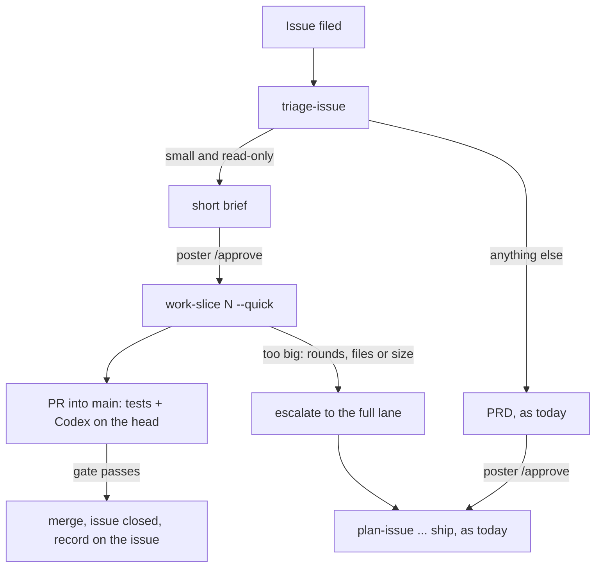
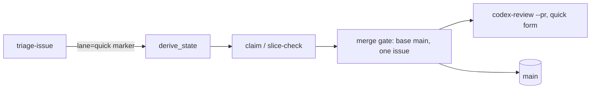

# PRD: a quick lane for small, safe changes (#181)

Approved revision 1, signed off by @jeromebanks on 2026-10-19 ([PRD](https://github.com/jeromebanks/twiddle/issues/181#issuecomment-6274481235), [sign-off](https://github.com/jeromebanks/twiddle/issues/181#issuecomment-6274555215), [approval record](https://github.com/jeromebanks/twiddle/issues/181#issuecomment-6274568460)). The text below is rev 1 exactly as approved.

> The sign-off said: "with all the default values you suggest". So every open question below takes its stated default.

## Problem

Every issue that reaches `sdlc:approved` goes down one road: a plan with Codex rounds, an epic with its own branch `epic/N`, slices, a milestone demo the poster must `/approve`, then `ship` to `main`. That is right for the alarm manager. It is far too much for a change that is one file and no risk: a new catalog station, a venue entry on a known platform, a typo-sized bug fix. Such a change costs about six sessions and three sign-offs, which is a reason to skip the process and commit straight to `main`. `main` is protected only by "a PR is required" (0 approvals, no required checks, no CI), so a PR opened by hand carries no recorded test run and no Codex review. `tools/sdlc.py`'s `test-record` and `codex-review` are the only gates the repo has.

Today the maintainer either pays the full cost (#182, "Add Psyched! Radio", is the case in front of us) or bypasses the SDLC. We want a third option that is cheap and keeps the gates.

## Users and scenarios

1. **Adding a station.** Jerome picks up a flyer for a radio station and files an issue. Triage sees it is a data-only catalog entry, read-only, one file. It posts a short brief (what station, which stream, what "done" looks like) and Jerome replies `/approve`. An agent builds it in its own worktree, the full suite is recorded on the head, Codex approves the PR, and the PR merges into `main` and closes the issue. No plan, no epic, no demo.
2. **A small bug** (an illustration). Suppose `dial list` showed a blank cell for a station with no logo. Triage reproduces it with read-only commands, posts a short diagnosis naming two files, Jerome approves, and the fix goes the same way.
3. **A change that turns out bigger.** An agent starts a "small" fix and Codex asks for changes three times, or the diff grows past the cap. The tool stops the quick lane and hands the approved brief to `plan-issue`, so the work continues in the full lane without a new PRD.
4. **A change that looks small but isn't.** An issue says "make `alarm try` skip the confirmation". It writes to a speaker, so triage refuses the quick lane and writes a full PRD.

## Scope

- In:
  - A second lane through the SDLC for small, read-only changes, from `sdlc:approved` to merged on `main`.
  - Eligibility rules, stated in one place. Triage applies the judgement ones; the tool enforces the mechanical ones at claim and merge.
  - A short brief (a short diagnosis for a bug) in place of the full PRD, signed off with `/approve` as today.
  - Building such a change with `work-slice` (a `--quick` mode), landing on `main` through the same recorded gates: full suite on the exact head, Codex approval of the exact head, an up-to-date base.
  - Evidence in the PR body in place of a milestone demo, and a record on the issue of what merged.
  - An escape from the quick lane into the full lane (`plan-issue`) that keeps the approved brief.
  - `SDLC.md`, `docs/sdlc.html` and the skills say how the lane works.
  - A one-line pointer in `add-radio-station`, `add-venue-source` and `add-visualizer`: under the SDLC the build runs inside `work-slice`, so don't open a PR by hand.
- A note, not a requirement: once this ships, #182 ("Add Psyched! Radio") is the first real use; it cannot be this epic's proof, because the tooling must be on `main` first.
- Non-goals:
  - The full lane (plan, epic, milestone, demo, ship) does not change for anything that is not quick.
  - No weaker gate: tests and Codex review stay mandatory, bound to the head, and a review that asks for changes still blocks.
  - Anything that writes to a speaker, or touches the SDLC tooling, the skills or the review logic, is never quick.
  - Not a way to skip the poster: `/approve` of the brief is required.
  - No change to branch protection on `main`.
  - No change to how Codex is run (`codex-review` stays the only way).

## App flow



## Screens

No screens. The visible surface is `uv run python tools/sdlc.py state N` and its `next:` line, for example:

```
#182 Add Psyched! Radio (San Francisco) to the stations
  state: approved   lane: quick   turn: agent   action: work_quick
  next: /work-slice 182 --quick
```

## Architecture proposal

Components touched, in `tools/sdlc.py` (stdlib only) and the skills; nothing under `src/twiddle/`:

- **Ledger.** The brief is a `prd` (or `diagnosis`) revision carrying a `lane=quick` marker. `derive_state` reads the marker, so `approved` plus `lane=quick` routes to a new action (build it) instead of `plan`. A brief that moves to the full lane drops the marker, and the existing planning path takes over.
- **Claim and slice check.** `claim` and `slice-check` today accept only a `plan:slice` issue made by `plan-create`, whose marker names an epic. They would also accept an approved quick issue, with the issue itself as the unit of work and `main` as the base.
- **Merge gate.** `merge_gate_errors` / `command_merge` require the PR to target `epic/N` and to close exactly one open `plan:slice`. For a quick issue the base is `main`, the PR closes that one issue, and review is never deferred to a milestone. GitHub closes the issue itself on a merge into the default branch; the tool still reads it back.
- **Mechanical eligibility.** At claim and again at merge, the tool refuses a quick PR whose diff touches a denied path (`tools/`, `.agents/`, `.claude/`, `.sdlc/`, the speaker-writing modules named in `CLAUDE.md`, `pyproject.toml`, `uv.lock`) or exceeds the size cap.
- **Codex review.** `tools/codex_review.py` `prepare_pr_round` requires the PR to target `epic/N` and fills the repo's PR prompt with `BASE` and `EPIC`; it needs a quick form (base `main`, no epic) and the prompt (`.agents/skills/work-slice/references/codex-pr-prompt.md`) to read for it.
- **Escape.** A tool step, `escalate-to-full N`, which clears the marker and sends the issue to `plan-issue`. Triggers are mechanical: more than 2 Codex change rounds, a diff that leaves the brief's stated files, or a diff past the cap.
- **Labels.** `claim` and `merge` move a quick issue's `sdlc:*` label as `claim` does for an epic today (`approved` to `in-progress`, then `done`).
- **Brief text.** A quick issue's body is the poster's request; the approved brief is a comment. The tools that read a slice's sections (`slice_check_errors`, `prepare_pr_round`) read the approved brief for a quick issue.
- **Skills and docs.** `triage-issue` (eligibility, `references/brief-template.md`), `work-slice` (a `--quick` section), `SDLC.md`, `docs/sdlc.html`, and the three `add-*` skills' one-liners.
- **Dependencies.** GitHub (`gh`), as the SDLC already uses. No new packages.



## Safety class

**Read-only for speakers, but it writes to GitHub and lets the agent merge a code change into `main` with no milestone demo.** (`merge-prd` already lets the agent merge a path-restricted, approved docs change; the quick gate is its sibling, as `prd_pr_errors` is for that.)

- It touches no speaker and makes no `interventions.jsonl` entry. Nothing in it needs `--dry-run` for a speaker; every writing `sdlc.py` command keeps its `--dry-run`.
- New risk: `main` receives work the poster approved only as a short brief, not as a demo of the result. The defence is the eligibility rules, above all "read-only, no speaker write, nothing in the SDLC or review logic", checked mechanically at merge, plus the same test and Codex gates as any slice. A quick change that is later found wrong is undone with an ordinary revert PR.
- The tool refuses to merge a quick PR that touches a denied path even if Codex approves.

## Acceptance criteria

1. Triage can mark an issue's brief or diagnosis as quick, and `state N` then shows `lane: quick` and, once approved, `next: /work-slice N --quick` instead of `/plan-issue N`.
2. `triage-issue` states the eligibility rules and a brief template; a change that writes to a speaker, adds a dependency, or touches `tools/`, `.agents/`, `.claude/`, `.sdlc/` or the speaker-writing modules is never given a quick brief.
3. `claim N --quick` makes a worktree and a branch off `origin/main` for an approved quick issue, and refuses an unapproved, non-quick, escalated or already-claimed one.
4. The merge gate for a quick PR requires: base `main`; the PR closes exactly that open quick issue; a passing full-suite record on the current head; a Codex approval of the current head (never deferred to a milestone); the head up to date with `main`; and a clean mergeable PR. Each unmet condition has its own message.
5. At merge the tool refuses a quick PR whose diff touches a denied path or exceeds the size cap (starting value: 5 files, 200 lines, set in `.sdlc/config.json`).
6. After a quick merge the issue is closed as completed and reads back so, and the issue carries a record of the PR, the head SHA, and the test and review records.
7. `escalate-to-full N` clears the quick marker, commits the approved brief to `docs/prd/N-slug.md` through the existing `merge-prd` path (the full lane's plan review and `plan-validate` read the PRD there), and `state N` then offers `/plan-issue N`; the tool triggers it on more than 2 Codex change rounds and on a diff outside the brief's stated files or past the size cap.
8. A `plan:slice` issue and the full lane behave exactly as before; the existing `tests/test_sdlc*.py` still pass unchanged.
9. `codex-review --pr PR` works for a quick PR (base `main`) and still refuses a slice PR that does not target its epic branch.
10. `SDLC.md`, `docs/sdlc.html`, the `triage-issue` and `work-slice` skills describe the lane, and `add-radio-station`, `add-venue-source` and `add-visualizer` each carry the one-line pointer.
11. All new behaviour has offline tests (`uv run pytest`), including the refusals above. Nothing touches the network, a speaker or Spotify.
12. One offline test runs a quick issue end to end against a scratch git repo with a bare "origin" (as `test_publish_demo_to_an_orphan_branch` does) and a faked `gh`: approved, claimed, built, gated, merged and closed. Its output is the milestone demo's evidence, run from `epic/N`.
13. A quick change's labels follow it: `claim` moves the issue `approved` to `in-progress`, a merge moves it to `done` (and closes it), an escalation to the full lane puts it back on `approved`; and `next` lists a quick issue only while it needs an agent.
14. A quick PR is checked and reviewed against the approved brief, never against the poster's raw request: the brief carries the slice's sections (Outcome, Scope, Acceptance criteria, Validation, Non-goals, Context), `slice-check` reads them there, and Codex's brief file is built from them.
15. When Codex cannot run on a quick PR, the PR stays open and the tool reports it (`review-defer` is refused: there is no milestone to owe the review to); a person decides between waiting and escalating to the full lane.

## Open questions

1. **Who merges a quick PR?** Default: the agent, once the gate passes, since a quick change is read-only by definition. If you would rather merge every one yourself, say so and the agent stops at "ready to merge".
2. **Size cap and denied paths.** Default: 5 files, 200 lines; denied paths as listed. They live in `.sdlc/config.json` so they can be tuned without code.
3. **Is the brief committed to `docs/prd/` as a PR?** Default: no, it stays a comment on the issue (a one-file change shouldn't need a second PR); it is committed through `merge-prd` only when the work escalates to the full lane, because `plan-validate` and `codex-review --plan` read the PRD from `docs/prd/`.
4. **How is a quick issue shown on GitHub?** Default: the marker in the brief comment, plus a non-state label `lane:quick` for filtering. The "one `sdlc:*` label per issue" rule is untouched.
5. **Does the quick lane use the complexity ratings (`routine` / `judgment` / `novel`)?** Default: triage rates it, with the model mapping from `.sdlc/config.json`; a `judgment` or `novel` change is not eligible.
6. **Should an "add a station" GitHub issue form pre-fill the brief?** Default: not in this epic; revisit after #182.
7. **After a quick merge, can the poster object?** Default: they comment on the issue and a revert PR follows through the same lane; there is no demo to `/changes`.
