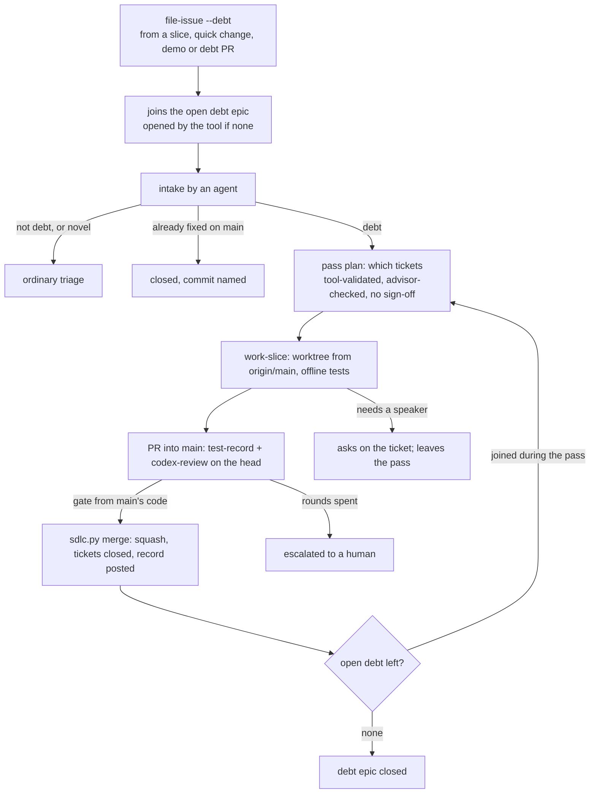

# PRD: a lightweight lane for tech debt, and SDLC lessons from #181/#182/#234 (#243)

Approved revision 1, signed off by @jeromebanks on 2026-10-21 ([PRD](https://github.com/jeromebanks/twiddle/issues/243#issuecomment-6324764605), [sign-off](https://github.com/jeromebanks/twiddle/issues/243#issuecomment-6326391850), [approval record](https://github.com/jeromebanks/twiddle/issues/243#issuecomment-6326417822)). The text below is rev 1 exactly as approved.

## Problem

Tech debt is filed carefully and then not done. `file-issue --debt` files it "budgeted into a cleanup pass after a milestone is accepted", but that pass only runs between two milestones of the same epic. When an epic has one milestone (#181), or once the epic has shipped, nothing picks the debt up and it has no owner. There are about 35 open `tech-debt` issues (as of 2026-10-21), none under a parent issue, most from #12 (the alarm manager) and #100 (repo-owned Codex reviews). Clearing #181's debt took a one-off override (#234): four PRs straight to `main`, each reviewed through a hand-made script around `tools/codex_review.py`, because `sdlc.py` has no path for a PR that is neither a slice nor a quick change. The rules and log of that override lived in the scratch directory and were lost in a reboot.

The full lane (PRD, sign-off, plan, demo, sign-off) is the wrong price for debt. The poster said so on 2026-10-21:

- no PRD for tech debt, "just a plan of which tickets", and no sign-off on that plan;
- no demo and no sign-off when it is done;
- "if new tech debt issues get discovered or filed, they should be included in [the] epic, and completed as well";
- debt is work a feature should have included to support itself; anything else is an ordinary issue, which goes through triage, and an agent may triage it.

Epics #181 and #182 and the #234 override also left a friction log (31 items, on #234). A few of those items cost the poster real time: they had to edit `.sdlc/config.json` by hand to get a plan through (#216), relay "continue" when `plan-create` stopped with no message, and could not record their own change request before a demo existed.

## Users and scenarios

1. **The backlog clears itself.** This ships. `uv run python tools/sdlc.py next` now lists the debt epic. An agent runs it: it reads every open `tech-debt` issue, closes the ones already fixed (with the commit that fixed them), sends the ones that aren't really debt to ordinary triage, and posts a plan of which tickets this pass takes. It builds each one as a PR into `main`, with the full suite and Codex's approval recorded on the head, and merges it. Jerome does nothing and is asked nothing. He sees issues close.
2. **Debt filed during a feature.** While building a slice of a new epic, Codex notes that a helper should also handle an empty list. The agent files it with `file-issue --debt`. It joins the open debt epic at once. Because the helper exists only on `epic/N` so far, the ticket waits until that milestone ships to `main`; then the debt epic's next pass takes it and gets it done. There is no cleanup pass, and the feature's demo isn't held up.
3. **Debt of debt.** Fixing #131 (a wait that counts sleeps, not wall time), the reviewer notices a second wait with the same flaw. That is in the ticket's own scope, so it's fixed in the same PR. It also notices a typo in an unrelated docstring. That is not debt of #131, so it is dropped, or filed as an ordinary issue if it matters. A third generation of debt can't be filed at all, so the lane always runs dry.
4. **Not really debt** (an illustration; intake decides). Intake might find that #152, "the alarm source picker can't take a pasted Spotify link", is a new feature rather than something the alarm manager needed to support itself. Then it drops `tech-debt`, says why on the issue, and the issue goes to ordinary triage. Intake also closes duplicates: #128 and #135 look like the same `CLAUDE.md` fix.
5. **A plan stuck on spent rounds** (M2). Codex and the planner don't agree on an amendment within `max_plan_rounds`. Today Jerome edits the config. After this, he types `/approve` on the latest plan revision and `plan-create` runs.

## Scope

Two milestones. M1 is what the poster asked for; M2 is the friction that cost the poster's own time.

### M1: the debt lane

- **One open debt epic.** The tool opens an issue for it (`lane:debt`) when open debt exists and none is open, and closes it when a pass ends with no open debt left. Every open `tech-debt` issue joins it as a sub-issue, whatever lane or epic filed it: a feature's slices, a quick change, a demo, or the debt lane itself.
- **Intake, by an agent, with no poster.** Each ticket that joins is checked against the definition of debt. One that is not debt loses `tech-debt` and goes to ordinary triage, with a note on the issue saying why. One that is already fixed on `main` is closed as completed, naming the commit. A duplicate is closed as a duplicate of the other. One that would need design choices (rated `novel`) also goes to triage.
- **Debt against code not on `main` yet.** Debt filed by a feature epic whose milestone hasn't shipped joins the debt epic but waits: no pass takes it until the code it is about is on `main`, and `state T` says what it waits for.
- **Passes, each a plan of tickets.** A pass is a plan comment on the debt epic: which tickets, in what order, which ones share a PR, a one-line scope and the files for each, and a `routine`/`judgment` rating. The tool validates it (every ticket open, debt, in this epic, in no other pass, within the pass size). The planner checks it with its advisor. There is no poster sign-off and no Codex round on the plan: Codex reviews every PR instead. Debt that joins during a pass goes into the next pass. A pass skips a ticket whose files overlap an in-progress epic's open slices, so debt merging into `main` doesn't make that epic's next `sync` conflict.
- **Building a ticket.** `work-slice` builds a debt ticket (or a small group of them) like a slice: its own worktree from `origin/main`, offline tests, a PR into `main` that closes exactly the tickets it fixes. The ticket is the spec. The full suite is recorded on the head with `test-record`, and Codex reviews the head with `codex-review --pr`, given the ticket and the pass plan's scope and files up front. A debt PR's review is never deferred, since no milestone review follows. A change round budget and escalation work as for a slice (`max_pr_rounds`). No demo, no sign-off, no ship.
- **Merging, from `main`'s own gate.** A debt PR merges only through `sdlc.py merge`, run from the primary checkout, never through a bare `gh pr merge`. The gate checks the base is `main` and up to date, the PR closes only open tickets of this pass, and a passing run and an approving Codex review are recorded on the exact head. Then it squash-merges, deletes the branch (remote too), closes the tickets and posts a record on each. Because debt may touch `tools/`, `merge` refuses to run when the running copy of the gate's code (`tools/sdlc.py`, `tools/sdlc_quick.py`) differs from `origin/main`'s. That applies to every lane, so it closes #239. `work-slice` stops running `merge` from the slice's worktree.
- **Debt filed by the debt lane** (how the lane stops, below): a finding inside the ticket's own scope is fixed in the same PR; a finding outside it is not debt of that ticket; second-generation debt may be filed, a third generation is refused.
- **What replaces the cleanup pass.** `/plan-issue N --cleanup` and `cleanup_slices_per_milestone` go: a feature's debt joins the debt epic straight away, and no feature epic waits on it. A quick change's debt joins it too, rather than waiting in the open list.
- **Debt that needs a person** (for example #96, "verify the album and track forms on a speaker"). The agent builds what it can offline and asks on the ticket in a `demo-request`-style comment, with the dry run and the `snapshot`/`restore` bracket. The ticket leaves the pass and waits. It never holds up the pass or the epic, and the agent never writes to a speaker.
- **`state` and `next` show it.** `state D` on the debt epic says what is due (intake, plan a pass, build a ticket, merge, or nothing). `next` lists it with the other agent work. `state T` on a debt ticket names its epic and pass.
- `SDLC.md`, `docs/sdlc.html`, `CLAUDE.md`'s `tools/sdlc.py` row and the `plan-issue` / `work-slice` / `triage-issue` skills describe the lane, and the "budgeted into a cleanup pass" wording goes from `file-issue`.

### M2: process fixes that cost the poster time

- **Plan review of an amendment reads `epic/N`** (#216). While an epic is being built, `codex-review --plan N` reads a scratch checkout of `origin/epic/N`, and the prompt says it is ahead of `main`. A new epic's first plan still reads `origin/main`.
- **A person can settle a plan** whose rounds are spent. The poster or a maintainer types `/approve` on the latest plan revision. That counts as consensus and `plan-create` may run. An agent never posts it.
- **The poster's own change request is recorded** with no demo posted. `/changes <what>` on an epic in progress is recorded (as `demo-changes` does after a demo) and planned as new slices.
- **`plan-create` never stops silently.** It either finishes and posts its record, or says what is missing and what to run. `state` recognises issues created without a record and offers to finish the creation, instead of `/plan-issue` again.

## Non-goals

- Out: rewriting the full lane for features. PRDs, plans, demos and ships stay as they are for everything that isn't debt.
- Out: building the existing debt issues (about 35) as part of this epic. Once M1 is on `main`, the lane clears them in its first passes. #239 is the exception, since M1's merge gate needs it.
- Out: a weaker gate. A debt PR needs the full suite and Codex's approval on its exact head, like any other PR. A review that asks for changes still blocks.
- Out: changing who may `/approve` a PRD. Ordinary triage still ends in the poster's sign-off; only the work of triaging may be an agent's.
- Out: any speaker write by an agent, in the lane or its tests.
- Out: changing branch protection on `main`, or how Codex is run (`codex-review` stays the only way).
- Out, listed as follow-ups for the planner to file (as ordinary issues, or `tech-debt` where a feature needed them):
  - a test that the commands `CLAUDE.md` calls read-only make no undeclared network git call, and a timeout on every `git fetch` (#234, item 18);
  - a single shared fake `gh` for the tests (#234, items 19 and 27);
  - a parallel test runner (`pytest-xdist`, items 22 and 31), and the timing flakes under load (#228, #233, #238);
  - Codex's sandbox can't run `pytest` (item 25);
  - nothing tracks in-flight work that isn't on GitHub (item 23);
  - a commit-attribution template or hook (item 29);
  - blockers between slices found only at the milestone review, and the cost of deferring routine slices' review (items 5 and 6);
  - the session can't subscribe to issue comments, so the poster relays "continue" (item 7);
  - the quick lane's cost for one file (item 12);
  - `gh issue view --comments` printing nothing (item 15), `.claude/skills` pointer files (item 30), and `git stash push tools/` for a fails-before check (item 26).

## App flow



## Screens

No screens. The visible surface is `state` and its `next:` line. For example (numbers illustrative):

```
#250 Tech debt [lane:debt]
  state: in-progress   turn: agent   action: work_debt
  pass 1: 6 tickets, 2 merged, 4 to build; 3 joined since (pass 2)
  next: /work-slice 131 --debt (sonnet: routine)

#131 test-record's GitHub wait counts sleeps, not wall time [tech-debt]
  debt of #100, generation 1; in #250's pass 1
  next: /work-slice 131 --debt (sonnet: routine)
```

## Architecture proposal

- `tools/sdlc.py`: the debt epic and its state (intake, passes, what is due), the `--debt` path through `claim`, `merge` and `next`, `file-issue --debt` adding to the open debt epic with a generation, the refusal when the running gate code differs from `origin/main`'s, and removing the cleanup pass. M2: the plan-review base, the plan settlement, `/changes` with no demo, and `plan-create`'s record.
- `tools/sdlc_quick.py`: where its gate rules are shared with the debt gate.
- `tools/codex_review.py`: a debt PR's prompt (the ticket, plus the pass plan's scope and files), and in M2 the plan review's base.
- `.sdlc/config.json`: a `debt` section for the defaults below; `lane:debt` in the labels; `cleanup_slices_per_milestone` removed.
- `.agents/skills/plan-issue`, `work-slice`, `triage-issue`: the pass plan, building and merging a debt ticket, intake hand-offs to triage.
- `SDLC.md`, `docs/sdlc.html`, `CLAUDE.md`: the lane, the merge permission, and the `tools/sdlc.py` row.
- `tests/`: offline, with the fake `gh`, as today. No new package or service.

### How the lane stops (design question 1)

Fixing debt finds more debt, so three rules bound it:

1. **Scope.** A debt ticket's review is held to the ticket's scope and files from the pass plan. A finding inside that scope is fixed in the same PR, not filed. A finding outside it is not debt of this ticket ("work the feature needed to support itself"), so it isn't filed as debt: it is dropped, or filed as an ordinary issue for triage when it matters.
2. **Generations.** Debt records the generation it came from: debt filed from a feature, a quick change or a demo is generation 1, and debt filed from a debt PR is its ticket's generation plus 1. `file-issue --debt` refuses past `debt.max_generation` (default 2) and says to file an ordinary issue instead. So every chain of debt has at most two links, and the lane runs dry.
3. **Passes.** Debt that joins during a pass waits for the next one, and a pass takes at most `debt.pass_size` tickets (default 8). If a pass ends with more debt joined during it than it closed, and the pass before did too, the lane stops and escalates the debt epic to a human, instead of planning another pass.

When a pass ends and no open debt is attached, the debt epic is closed. The next `file-issue --debt` opens a new one.

### How a debt PR's merge is allowed (design question 2)

Claude Code's permission check refused sub-agents' `gh pr merge` ("Merge Without Review") during #234, even with the poster's approval in the orchestrating session, and it rightly refuses an agent editing its own permissions. This isn't special to debt: slices and quick changes also merge through `sdlc.py merge`, which runs `gh pr merge` inside it. So, for every lane:

- **The merge is never a bare `gh pr merge`.** It is `uv run python tools/sdlc.py merge PR`, run from the primary checkout on `main`, whose gate has the review the check is looking for: a passing suite and Codex's approval recorded on the exact head, nothing deferred, and gate code identical to `origin/main`'s.
- **Who runs it, as expected:** the session that built the PR, sub-agent or not, once the poster has added one permission rule that allows exactly `uv run python tools/sdlc.py merge *` (and `cleanup *`) to `.claude/settings.json`. The poster adds it once by hand: `.claude/` is a denied path and the agents can't edit their own permissions, by design. The rule is written out in `SDLC.md`. That an allow rule clears the check for a sub-agent is expected, not yet shown, so the M1 demo confirms it with a real sub-agent merge.
- **The guaranteed path, with or without the rule:** a sub-agent that is refused leaves the PR ready, and `state` says `merge PR` is due, with the gate's results. The orchestrating session, which the poster runs, runs that one command. Nothing is ever merged around the gate.

## Safety class

**No speaker is touched.** Every command here writes only to GitHub (comments, labels, issues, sub-issue links, PRs and merges into `main`) and to git worktrees under `.worktrees/`, like the rest of `tools/sdlc.py`. It belongs in the `tools/sdlc.py` row of `CLAUDE.md`'s table, not the speaker rows. Nothing is journalled to `logs/interventions.jsonl`, because nothing writes to a speaker. The `--dry-run` that `tools/sdlc.py`'s writing commands take today extends to the new ones.

A debt ticket may change code that writes to a speaker (the alarm server, for example). It is built and tested offline only, like any slice. When a ticket's own verification needs a real speaker, the agent asks a person on the ticket, with the dry run and the `snapshot`/`restore` bracket, and never runs the write itself.

## Acceptance criteria

### M1

1. With open `tech-debt` issues and no open debt epic, the tool opens one (`lane:debt`) and adds every open `tech-debt` issue to it as a sub-issue. It does this once: a second run adds nothing.
2. `file-issue --debt` from a feature slice, a quick change, a demo or a debt PR adds the new issue to the open debt epic (opening one if none), and records its generation. From a debt PR whose ticket is at `debt.max_generation`, it refuses and names the ordinary `file-issue` instead.
3. Intake is done by an agent with no poster comment. A ticket judged not debt, or `novel`, loses `tech-debt`, leaves the debt epic, goes to `sdlc:triage` with a note saying why, and appears in `next` as `/triage-issue T`. A ticket already fixed on `main` is closed as completed, with the commit named. A duplicate is closed as a duplicate, naming the ticket it duplicates.
4. A pass plan posted on the debt epic is checked by the tool: each ticket open, `tech-debt`, a sub-issue of this epic, in no other open pass, and at most `debt.pass_size` tickets. A plan that breaks one is refused with the reason. No poster `/approve` and no Codex plan round is asked for.
5. `state` on the debt epic gives the action due (intake, plan a pass, a ticket to build, a PR to merge, or none) and a `next:` line. `next` lists the debt epic's work. `state T` on a debt ticket names its epic, its pass and its generation.
6. `claim T --debt` makes `.worktrees/slice-T` on `slice/T` from `origin/main`. It refuses a ticket that isn't in the current pass, is already claimed, or is waiting on a person.
7. `codex-review --pr` on a debt PR reviews the head against the ticket(s) it closes and the pass plan's scope and files, and `pr-review` records it. `review-defer` is refused for a debt PR.
8. `merge` on a debt PR squash-merges into `main` only when every one of these holds: the base is `main` and the head is up to date with it; the PR closes only open tickets of the current pass; a passing `test-record` and an approving Codex review are recorded on the current head; and it is mergeable. It then closes the tickets as completed (read back), deletes the PR's branch on GitHub as well as locally, and posts a record on each ticket and on the epic. Otherwise it lists every refusal and merges nothing.
9. `merge`, for any lane, refuses when it is run from a checkout whose `tools/sdlc.py` or `tools/sdlc_quick.py` differs from `origin/main`'s, and names the primary checkout. `work-slice` runs `merge` from the primary checkout.
10. `SDLC.md` writes out the permission rule for `.claude/settings.json` that lets any session, a sub-agent included, run `sdlc.py merge` and `cleanup` for every lane. When a session is refused, `state` on the PR's issue says `merge PR` is due with the gate's results, so the orchestrating session can run it. No skill or tool merges a PR with a bare `gh pr merge`. (The M1 demo checks a real sub-agent merge with the rule in place.)
11. Debt filed by a feature epic against a milestone that hasn't shipped is in the debt epic but in no pass until that milestone ships; the pass validator refuses it, and `state T` says what it waits for. A pass also refuses a ticket whose files overlap an in-progress epic's open slices.
12. When the last ticket of a pass merges, debt that joined during the pass forms the next pass. When none is left, the debt epic is closed and moved to `sdlc:done`. If two passes in a row each end with more debt joined than closed, the epic is escalated instead of planning another pass.
13. A ticket whose verification needs a speaker write gets a request on the ticket (its dry run and the `snapshot`/`restore` bracket) and leaves the pass. The pass can finish without it. `state T` says it waits on a person.
14. `/plan-issue N --cleanup`, `cleanup_slices_per_milestone` and the "budgeted into a cleanup pass" wording are gone. An accepted milestone no longer waits for a cleanup pass.
15. `SDLC.md`, `docs/sdlc.html`, the `plan-issue` / `work-slice` / `triage-issue` skills and `CLAUDE.md`'s `tools/sdlc.py` row describe the debt lane, its stopping rules and its merge permission. The full suite passes offline.

### M2

16. While an epic is in progress (an `epic/N` exists), `codex-review --plan N` reads a scratch checkout of `origin/epic/N`, and its prompt says it is the epic's branch, ahead of `main`. A new epic's first plan still reads `origin/main`.
17. Once a plan's Codex rounds are spent, `/approve` on the latest plan revision, from the issue's author or a collaborator, counts as consensus and `plan-create` may run. One from anyone else is listed as ignored, and an agent comment never counts.
18. `/changes <what>` from the poster on an epic in progress with no demo posted is recorded, and `next:` says `/plan-issue N` to plan it as new slices.
19. If `plan-create` stops partway, it says what was made and what to rerun. `state` on an epic with created issues and no creation record offers to finish the creation, not `/plan-issue N` again.

## Open questions

None blocks this PRD. Each takes its default unless you say otherwise:

1. **The permission rule.** Merges by a sub-agent need you to add one project permission rule once, in `.claude/settings.json`, allowing exactly `uv run python tools/sdlc.py merge` (and `cleanup`). If you don't, the orchestrating session runs each merge. *Default: you add it after M1 ships; `SDLC.md` gives the exact text.*
2. **Debt PRs go straight into `main`,** one squash per PR, not through an `epic/N` branch and a ship. Each one has its own suite run and Codex review, like a quick change. *Default: straight into `main`.*
3. **No Codex review of a pass plan.** The tool checks the list, the advisor checks the order, and Codex reviews every PR. *Default: none.*
4. **Pass size and generations.** *Default: `debt.pass_size` 8, `debt.max_generation` 2.*
5. **Several tickets in one PR.** Small tickets on the same files (two doc fixes, say) may share a PR when the pass plan groups them. *Default: up to 4 tickets in a PR.*
6. **The old cleanup pass goes**, rather than running alongside the debt lane. *Default: it goes.*
7. **Debt that needs a speaker** asks you on the ticket and waits, without holding up anything else. *Default: as described; nothing else asks for your time.*
