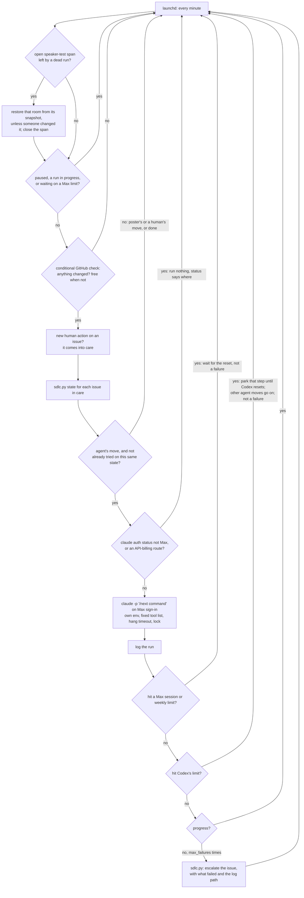
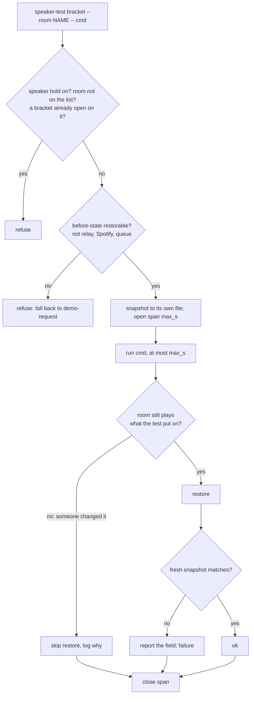
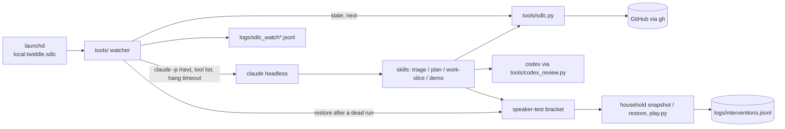

# PRD: SDLC: the session can't follow issue comments, so the poster relays "continue" (#263)

Approved revision 4, signed off by @jeromebanks on 2026-11-02 ([PRD](https://github.com/jeromebanks/twiddle/issues/263#issuecomment-6591879170), [sign-off](https://github.com/jeromebanks/twiddle/issues/263#issuecomment-6592096146), [approval record](https://github.com/jeromebanks/twiddle/issues/263#issuecomment-6592109107)). The text below is rev 4 exactly as approved, from *Problem* on; its "Changes from rev 3" note is on the issue.

## Problem

When you reply on an issue (an answer, `/approve`, `/changes`, a reply to a demo), nothing happens until someone opens a Claude Code session and says "continue" or types the `next:` command. `tools/sdlc.py` already knows whose move it is and what to run (`state N`, `next`), but nothing runs it when the move comes back to the agent.

A session has no way to follow issue comments. The GitHub MCP server fails to connect ("Authorization header is badly formatted": its `GITHUB_PERSONAL_ACCESS_TOKEN` is unset). Even once that's fixed, it would answer queries but push no events. So you end up relaying between GitHub and a terminal. Work that needs nobody waits for a session too, such as the next slice after a merge, or a demo once a milestone's slices are in.

You want the SDLC to react to GitHub on its own: you comment on the issue and the agent's next step starts by itself. **It must cost nothing beyond your Claude Max and Codex subscriptions.** API billing is too expensive, so a design that can fall back to it is not acceptable.

A second, smaller problem: the SDLC today never lets an agent write to a speaker. A milestone demo's speaker step becomes a `demo-request` that waits for you to run it. That's one more relay. You're happy for an agent to interrupt a speaker briefly, even while you're listening, provided it puts the room back as it found it.

Everything the steps need is on this Mac: the `claude`, `codex` and `gh` sign-ins, the suite (`uv run pytest`) and the worktrees. The repo already runs launchd agents (`src/twiddle/daemon.py`: the monitor and the alarm server). There is no `.github/workflows`.

## Users and scenarios

1. **A reply picks itself up.** Jerome reads a PRD on his phone and types `/approve`.
   - Within a minute or two, a watcher on his Mac sees that `state` now says `record_approval`.
   - It runs the triage skill headless, which records the approval and commits the PRD.
   - Then it runs `plan-issue`, and later the slices.

   He opens nothing. The issue's comments show each step as it is done, as they do today.
2. **A chain with nobody in it.** A slice merges into `epic/N` at 2am. The next ready slice is claimed and built on the watcher's next poll. That repeats until the milestone is complete and its demo is posted. Then it is Jerome's move, and the watcher waits. Nothing ships to `main` until he types `/approve` on the demo.
3. **A step that keeps failing.** `work-slice 160` hits a permission refusal it can't get past headless.
   - The watcher logs the failure and tries once more on the next change.
   - When the second run makes no progress either, it escalates the issue (`sdlc:escalated`) with a comment saying what failed and where the log is.

   It doesn't retry that issue every minute all day.
4. **Max's limit is reached.** At 4pm, halfway through a slice, a run reports that the Max session limit has been hit.
   - The watcher starts nothing more until the limit resets, and `status` says when that will be.
   - It doesn't count that run as a failure, and it doesn't retry in a loop. Nothing falls back to API billing.
   - When the limit resets, the slice is picked up on the next check.

   A weekly limit works the same way, with a longer wait.
5. **An API key turns up.** A shell profile picks up `ANTHROPIC_API_KEY` for some other project. The watcher's environment is its own, so the key never reaches `claude`. If one shows up anywhere `claude -p` would read it (the plist, a Claude Code settings `env` block, an `apiKeyHelper`), the watcher runs nothing, and `status` names where it is.
6. **Driving by hand.** Jerome wants to work an issue himself in a session. He invokes the pause skill in that session (or runs the pause script in a terminal), for everything or just `243`, works, and then resumes the same way. While it is paused the watcher starts nothing new, and `status` says so.
7. **A speaker test while he's listening.** Jerome is listening to KALX on the Roam through `twiddle dial`. A demo step needs to show a station playing on the Roam. The agent runs the speaker-test bracket on `roam`:
   - It records what the room is doing: the stream, the volume, and the rest of what a snapshot holds.
   - It plays the demo station for at most its bound, say 60 seconds.
   - It puts KALX back at the same volume, then checks that the room matches what it recorded.

   The whole window is one journalled span, so `analyse` discounts anything the daemon sees inside it. Jerome hears a minute of something else, then his station again.
8. **The run dies mid-test.** A run is stopped while its bracket is open (its timeout, a crash, a Max-limit stop). The watcher notices the span that never closed and restores the room from the saved snapshot before it starts anything else.
9. **He changes station mid-test.** Halfway through the test, Jerome tunes the Roam to WFMU himself. At the end, the room is no longer playing what the test put on, so the bracket leaves it alone. Restoring KALX would clobber his choice. It logs that it skipped the restore and why.
10. **Codex runs out mid-slice.** Codex asked for changes on slice 161. The fix is pushed, and the re-review hits Codex's usage limit. `review-defer` refuses here, because findings that no round approved can't be deferred.
    - Slice 161's PR stays open. Its review step is parked "waiting on Codex", with the reset time if Codex gave one.
    - On the next check, `sdlc.py` names another move: ready slice 162 of the same epic, or the next step on another issue in care. The watcher runs that.
    - Once Codex's limit resets (or the back-off ends), `sdlc.py` names resuming slice 161 as the move, and the watcher runs it.
    - For a milestone review that hits the limit, the epic's new slices already wait for that review. So only other issues in care go on meanwhile.

    Nothing counts as a failure, and nothing is merged without the review the gates require.

## Scope

- In: a launchd agent, `local.twiddle.sdlc`, installed, uninstalled and checked like the existing two (`--install`, `--uninstall`, `--status`). Install and uninstall take `--dry-run`.
- In: **subscription only, never API billing.** This is a hard requirement.
  - Every Claude run is `claude -p` on your Max sign-in: the keychain `/login`, or a `claude setup-token` token kept out of any file in the repo.
  - The watcher builds the environment it hands `claude` from an allowlist. It does not inherit your shell's, and the plist carries no Anthropic credential.
  - Before installing, and before every run, it asks `claude auth status --json`, with the environment the run will get. It refuses unless that reports `authMethod` `claude.ai`, `apiProvider` `firstParty` and `subscriptionType` `max`. Without this check, a Console account signed in through `/login` would bill the API with no key in sight.
  - It also checks that no API-billing route is in place: `ANTHROPIC_API_KEY`, `ANTHROPIC_AUTH_TOKEN`, an `apiKeyHelper` or one of those keys in a Claude Code settings file's `env`, or a Bedrock or Vertex switch (`CLAUDE_CODE_USE_BEDROCK`, `CLAUDE_CODE_USE_VERTEX`). If it finds one, it runs nothing, and `status` says where.
  - It never passes `--bare`, which requires an API key.
  - The environment it hands on also drops `OPENAI_API_KEY`, so the skills' Codex reviews stay on your Codex sign-in.
  - The one setting it can't check is usage credits on claude.ai, which could bill for use past Max's limits. With no budget, that setting is the only thing between "run until Max runs out" and a bill. So install prints a reminder to keep them off or set to $0, `status` repeats it, and the docs say the same.
- In: every minute it checks whether anything on GitHub changed.
  - The check is a conditional GitHub request. When nothing changed, the answer is "not modified". That costs no tokens and, per GitHub's docs, doesn't count against its rate limit ([conditional requests](https://docs.github.com/en/rest/using-the-rest-api/best-practices-for-using-the-rest-api#use-conditional-requests-if-appropriate)). Which endpoints together cover new comments, label changes and new issues is the planner's choice.
  - Only when something changed does it work out whose move it is, through `sdlc.py` (`state` / `next`). It never decides that for itself.
  - For an issue it is minding where it is the agent's move, it runs that issue's `next:` command as a headless `claude -p` session in this repo.
  - `next:` is free text (`/work-slice 160 (opus: judgment)`, `/milestone-demo 243: #243 M1: ...`). The leading slash command is what runs, and the model comes from its parenthesis.
  - A `next:` that isn't a slash command (`sync N`, `merge PR`, `commit-prd N`) runs only through a fixed mapping in the repo, as that one `sdlc.py` command. Anything else is skipped and shown in `status`.
- In: **which issues it minds.** It never sweeps the backlog: today `next` lists 47 issues, 45 of them untriaged, and it takes none of them on by itself.
  - An issue comes into its care when a person acts on it after the watcher is installed: a comment, `/approve`, `/changes`, or a new issue they open.
  - The poster can also adopt an issue by name (`adopt N`, which is how #100 or #243 would join).
  - **A person** means what `state` already means by it. The agent posts through `gh` under the same login as the maintainer. So an action counts only when it has no `sdlc:v1` marker, and comes from the issue's author or someone who can write to the repo.
  - A marked comment or a marked issue body never brings an issue into care: the agent's own notes, a `file-issue` finding, a tech-debt issue (#263 itself was filed that way), or a headless run's comments.
  - It stays in care while it is the agent's move, agent-only chains included (slice after slice, a milestone's demo). It leaves care when the move is the poster's or a human's (`escalated`, `conflicts`), or when the issue is done.
  - Slices of a minded epic are covered by the epic.
- In: one run at a time across all issues, held by a lock.
- In: **a per-run timeout, for hangs only.** A run that passes it is stopped, logged, and counted as a run with no progress. It is set well above the longest normal step (default 4 hours), so it ends only a run that has wedged, not long work. There's no turn cap and no daily limit on runs.
- In: **no budgets.** There's no daily run budget, no turn cap and no dollar figure. `--max-turns`, `--max-budget-usd` and `total_cost_usd` aren't used: the last two are list-price estimates, not what Max charges. The watcher runs as long as there is an agent's move to make and Max allowance to make it with.
- In: **Max's own limits.** Your Max session allowance and weekly allowance are the ceiling, and the watcher's runs share them with your own sessions.
  - When a run reports that a session or weekly limit was hit, the watcher starts nothing until the reset time the run gives. If it gives none, it waits a back-off from config.
  - Then it continues where it left off.
  - It doesn't count that run as a failure toward escalation, and it never retries before the wait ends.
  - `status` shows that it is waiting, which limit, and until when.
- In: a fixed list of the tools a headless run may use. The list lives in the repo, is reviewed like code, and is passed to `claude` on its command line. It is never `bypassPermissions` or a skip of the permission check. The model is the one `next` names (for example `opus: judgment`).
- In: **not repeating itself.** These rules are loop guards, not budgets:
  - **Progress** is the issue's `state` changing: its state, its action or its `next:` line.
  - After a run, the watcher starts the same `next:` command for that issue again only if that has changed, a person has commented since, or a Max or Codex wait on that step has ended.
  - Its own comments and labels don't count, so a run that posts a note and then fails doesn't re-trigger itself.
  - After `max_failures` runs on the same issue with no progress (default 2), it escalates the issue through `sdlc.py`, never by editing labels by hand.
  - A chain that is making progress is still bounded by the gates' own round limits (`max_rounds`, `max_plan_rounds`, the Codex review rounds, `max_change_rounds`), which already escalate.
- In: **a pause/resume skill and a script.**
  - A skill, invocable from a Claude Code session like the other SDLC skills, that pauses the watcher (all issues, or one) and resumes it. It reports `status` after.
  - A plain script that does the same from a terminal.
  - Both act through the watcher's own `pause` / `resume`. They write only the watcher's record.
  - A headless watcher run can't use either. Neither is on the run's tool list, and pause/resume refuse inside a watcher run. So a run can't pause or unpause the watcher.
- In: **a Codex limit parks one step, not the watcher.**
  - When a run's output shows Codex's usage limit, the step that needed Codex (a slice review, a plan review, a milestone review) is parked. It's marked "waiting on Codex" until the reset time Codex gives, or for a back-off from config.
  - Meanwhile the watcher keeps running other agent moves: other ready slices of the same epic that the milestone rules allow, and other issues in care.
  - The parked step doesn't count toward `max_failures`. It runs again, as `next:` names it, once the wait ends.
  - `review-defer` still applies wherever its rules allow a deferral: a full-lane slice whose review Codex can't run, unless Codex asked for changes that no later round approved. Routine slices aren't affected at all, since `slice_review` already reviews them with their milestone. The parked wait is for the cases `review-defer` refuses: a re-review with unapproved findings, a quick change, a plan review or a milestone review.
  - Which move comes next is still `sdlc.py`'s decision. Today an epic's `next:` already offers another ready slice before the one in flight.
  - When the only agent move is resuming in-flight work, `next:` today says "nothing new to start: in progress #161 (`/work-slice 161` resumes one)". That isn't a runnable command, so `sdlc.py` is extended to name the resume as one. The watcher's park record holds it back until the wait ends.
  - The watcher never chooses the move for itself. How `sdlc.py` does this is the planner's call. The same applies to resuming after a Max limit.
  - `status` shows each parked step and when it will be retried.
- In: `pause` / `resume` (all issues, or one), `adopt N` / `drop N`, and a read-only `status`. `status` shows:
  - whether it is alive or paused;
  - the issues in care;
  - the last and current run;
  - any wait on a Max limit, and any step parked on a Codex limit;
  - any API-billing route it found, and any credential it can't reach;
  - the usage-credits reminder;
  - any open speaker-test bracket.
- In: a log of every poll and run under `logs/` (gitignored, like the others). Each run's own output goes in a file it names.
- In: its record of what it has already acted on can be lost (#260's case: a reboot, a wiped scratch directory). It rebuilds from GitHub: the issues' state, the SDLC's own marked comments, and the issues in care. The worst a lost record can cost is one repeated run per issue.
- In: **brief speaker tests, through one bracketed command only.** See *Speaker tests* below.
- In: **it lands after #243 M1.** M1 changes where `merge` must run from: the primary checkout, with gate code equal to `origin/main`'s. It also adds the permission rule that lets a session that isn't the poster's run `sdlc.py merge`.
  - A headless `claude -p` is such a session. Claude Code's "Merge Without Review" check refused sub-agents' merges during #234.
  - Without that rule, the first unattended chain stalls at its first merge.
- In: `SDLC.md`, `docs/sdlc.html` and `CLAUDE.md` describe it: the read-only vs writing table, the layout table, and a "the SDLC watcher" section beside "The daemon". `SDLC.md`, `docs/sdlc.html` and `CLAUDE.md` also state the SDLC-wide speaker rule: an SDLC agent may write to a speaker only through the bracket. `SDLC.md`'s two "never" lines change to match. Rewording the three skills' "never" lines is the follow-up under *Non-goals*, not this feature.

## Speaker tests

An agent may briefly take over a room to test something, then put it back exactly as it was. Every rule below comes from `CLAUDE.md`'s existing ones: target by name, `snapshot` before, `restore` after, every write journalled, and alarms bracketed separately. What's new is that an agent may now run the write itself, and that the rules are enforced by the bracket rather than by the agent remembering them.

**One command, one process.** A speaker test is a single bracketed command that wraps the test's own command. Within one process, the bracket:

1. checks the room and the before-state are allowed (below);
2. takes a snapshot to a file of its own;
3. opens a journalled span with a finite `max_s`;
4. runs the test command;
5. restores the room;
6. checks the restore;
7. closes the span.

It is never three separate tool calls spread across an agent's turns, because a run can end between any two of them. The restore runs on failure, on the test command's own timeout and on interruption (a `finally`, and a signal handler for SIGTERM and SIGINT). When the watcher stops a run at its hang timeout, it sends SIGTERM to the run's whole process group first, so a bracket inside it restores itself, and SIGKILL only after a short grace period. For the case a process can't clean up after itself (SIGKILL, a crash), the snapshot is on disk and the span is open, with the bracket's PID recorded in it. The watcher closes it: after any run ends, and at startup, it looks for an open speaker-test span whose process is gone, or whose `max_s` has passed, and restores that room from that span's snapshot before it starts anything else. An open span whose process is still alive and within its limit is left alone, since a bracket can outlive the `claude -p` that started it. `alarm serve`'s `close_stale` is the precedent.

**Short and bounded.** Each bracket has a hard limit, default 2 minutes and at most 5 (config). The bracket stops its test command there and restores. The span's `max_s` is that limit, so `analyse` ends an unclosed span there too.

**Journalled, so `analyse` discounts it.** Every speaker write inside the bracket goes through `play.py` and lands in `logs/interventions.jsonl` as today, and so does the restore. The bracket adds a span (`sdlc_speaker_test_start` / `_end`, with its own `span_id`, the room, the issue and the command) around the whole window. A single journalled write is discounted for only 45 seconds, and a two-minute test is longer than that. The span covers all of it.

**By room name, from a list you keep.** The bracket takes `--room NAME` and resolves it the way the control commands do (`Invisible`, the `Coordinator` attribute, bonded followers routed to their coordinator and said so). It never takes an IP. It refuses any room not on `.sdlc/config.json`'s speaker-test list. The default list is just `roam` (CLAUDE.md's example room); you add others.

**Put back exactly, and checked.** After `restore`, the bracket takes a fresh snapshot and compares every field a snapshot covers: the source URI and metadata, the transport state, the play mode, each member's volume, mute, bass, treble, loudness and balance, and the position for a track. `Snapshot.restore` today quietly swallows a failed mute, EQ or balance write. The check catches that. Any mismatch is reported in the run's output, logged, and treated as a failure. If the run can't fix it, it escalates the issue, saying which room and field, so a person knows the room was left wrong.

**Don't clobber the listener.** Before restoring, the bracket checks the room's source against the source as of the bracket's last journalled write inside the span (what the test itself put on). If it differs, a person has put something else on meanwhile: it skips the whole restore and logs why. A change of volume alone isn't treated as a takeover: the room is restored, volume included, because the test may itself have set the volume. This is the rule scene's `R` and dial's `d` already follow. The same check applies when the watcher restores after a killed run.

**One at a time.** Only one bracket may be open on a room at once, across the watcher's runs and your own sessions. A second is refused while one is open. Each bracket's snapshot file is its own (named by its span), so it never overwrites `logs/snapshots/<room>.json` or another test's snapshot. SDLC.md's "only one session touches a speaker at a time" then holds by lock rather than by habit.

**What a room snapshot can't put back, and so what is excluded.** `snapshot` covers one room's transport and volume (the fields listed above). It does not cover:

| Not covered | Why it can't be bracketed | Rule |
|---|---|---|
| Alarms | household-wide, and a deferred write that fires after the bracket has closed | No alarm write inside a bracket (`alarm add/edit/enable/disable/rm/restore/try/stop/snooze`). An alarm demo step stays a `demo-request`. |
| A sleep timer | deferred: it stops the room after the bracket closes | No `sleep <duration>` |
| Groups | a snapshot holds one group's state, not who is grouped with whom | No `group` / `ungroup` |
| The queue's contents | `restore` re-points at the room's queue but doesn't refill it | No command that clears or adds to the queue (`diag serve` and the other file-playing paths) |
| The relay process, and Spotify's playback | Spotify's session lives in Spotify's cloud, and the relay is its own process; re-issuing the URI doesn't resume either | No `relay start/up/down`, `spotify play`, `spotify discover`, `comedy sleep` |

The bracket allows only what it can undo:
- `stream` / `tune`, playing a station or a URL;
- `play`, `pause`, `stop`, `next` and `prev`;
- `volume`, `mute`, `bass`, `treble`, `balance`, `loudness`, `shuffle` and `repeat`;
- a TUI driven headless (dial or scene through `tools/demo_shot.py`), only if its writes are held to the same list at the write layer (below).

**The bracket runs only those, and only on its own room.** The test command is not free text: it must be one of the allowed `twiddle` verbs above, run directly (never through a shell), with no `--room` other than the bracket's own. Anything else is refused before it starts: another verb, another room, a command that isn't `twiddle`. Because a TUI's writes are keypresses, not verbs (dial's `d`, its Spotify pause before tuning on the relay), the check also lives where writes are made: while a bracket is open, a speaker write that isn't on the list, or that targets any group but the bracket's, is refused before it reaches the speaker, and so is any Spotify write. If the planner finds that check can't be made for a TUI, TUIs come off the list and stay a `demo-request`. Without these rules a pattern that allows the bracket would allow any command inside it, which is what the tool list exists to stop.

It also **refuses to start** when the room's before-state is one `restore` can't reproduce:
- the room is on the relay;
- the room is playing Spotify (or another cloud service's session);
- the room is playing from its queue;
- the room is grouped differently from when the bracket started.

Those fall back to a `demo-request`, as today. Your example is covered: a station from `dial` on the Roam is a stream URI, which `restore` re-issues at the same volume.

**An agent can't hear.** CLAUDE.md's rule still applies: a speaker reporting `PLAYING` doesn't mean sound came out. An agent's speaker test can show that the transport reached the room, and it can screenshot what the TUI showed. It can't show that you heard it. So a demo criterion that is about what someone *heard* stays a `demo-request` to a person, and the reply is recorded with `observe.py` as now. Speaker tests remove the relay for "does it play there"; they don't remove it for "did it sound right".

**The daemon and fault capture.** Speaker tests keep the daemon's evidence honest, because the span makes `analyse` discount the window. But each test is a window of evidence lost. CLAUDE.md asks you to avoid writes while waiting to capture a real fault. So there is a **speaker hold**, which you set and lift (`speakers hold` / `speakers allow`). It is local state on this Mac (under `logs/` or `~/.config/twiddle/`), never an edit to the committed `.sdlc/config.json`, so toggling it needs no commit. While it is on, every bracket refuses, in the watcher's runs and your own sessions alike. `status` shows it. It is off by default, and you turn it on by hand while you wait for a real dropout (your answer 3).

**Where this applies: SDLC-wide.** Any SDLC agent, headless or interactive, may run a speaker test through the bracket, and no other way. `SDLC.md` and `CLAUDE.md` (a row for the bracket) say so. Slice tests stay offline. The bracket is for demos and for diagnosing a bug against the real household, never for a slice's test suite.

This feature changes `SDLC.md`'s two "never" lines to match: "Only one session touches a speaker at a time" (now held by the bracket's lock), and *Milestone demos* step 1. It updates `docs/sdlc.html` to match too.

Three skills also say that an agent never runs a speaker write:
- `work-slice`, step 4;
- `milestone-demo`, its step-kinds list and its "Writes ... are never run by you" rule;
- `triage-issue`, step 5.

Changing those to "only through the bracket" is a **separate ticket** (see *Non-goals*). Until it lands, the skills are stricter than the policy, and agents follow them. So demos' speaker steps stay `demo-request`s until then.

## Non-goals

- Out: anything that bills the Anthropic API, or that bills beyond the Max and Codex subscriptions.
- Out: event-driven delivery. You've accepted polling for now, because there's no no-cost way for GitHub to notify this Mac. **Follow-up: revisit event-driven delivery if development scales up or moves to the cloud** (a self-hosted runner, a GitHub App webhook, or cloud-hosted agents).
- Out: a custom channel (rev 2's B), a self-hosted Actions runner (C), hosted Actions, cloud routines, Desktop scheduled tasks and `/loop` (D), and fixing the GitHub MCP server. Fixing that server is worth doing for your own sessions (set `GITHUB_PERSONAL_ACCESS_TOKEN`, then `/mcp`), outside this feature.
- Out: a webhook into the Mac, since it would need a public endpoint or a tunnel. `gh webhook forward` is documented as being for testing only.
- Out: budgets in runs, turns, minutes or dollars. (The hang timeout isn't one: it ends only a wedged run.)
- Out: triaging or building the existing backlog on its own. Adopting issues is the poster's call.
- Out: changing any gate. PRD and demo sign-offs, `ship`'s checks and the Codex reviews stay as they are. The watcher only runs what `next:` already says, and the gates decide whether it succeeds.
- Out: ever posting `/approve`, or anything else in the poster's voice.
- Out: speaker writes outside the bracket, alarm and sleep-timer writes by an agent, and any write to the relay or to Spotify by an agent.
- Out: running several issues at once, or on more than one machine.
- Out: notifications beyond GitHub's own (the agent's issue comments already notify the poster).
- Out: #260's general problem (in-flight work with no durable home). This feature only keeps its own record rebuildable from GitHub.
- Out: **rewording the skills for the SDLC-wide speaker rule.** That covers the "never run a speaker write" lines in `work-slice`, `milestone-demo` and `triage-issue`. They change to "only through the bracket". **Follow-up to file:** a separate issue for that clean-up, once this PRD is approved. It isn't part of this workflow's flow.

## App flow





## Screens

No TUI. A new read-only `status` (wording illustrative):

```
SDLC watcher (local.twiddle.sdlc): alive, checking every 1m, last check 14:32
  billing:  claude.ai sign-in, Max; no API key, helper or Bedrock/Vertex switch found
            usage credits can't be checked: keep them off (claude.ai/settings/usage)
  running:  #243 /milestone-demo 243 (opus: judgment), started 14:20, hang limit 18:20
  in care:  #243 in-progress (agent's move)
            #263 prd-review (waiting on the poster)
            #100 in-progress, paused by you
  Max:      not limited (last limit hit: weekly, reset Mon 09:00, resumed)
  Codex:    #161 review parked, Codex limit, retry 17:05; meanwhile #162 ran
  speakers: allowed; rooms: roam; open bracket: roam since 14:31 (limit 14:33), #243
  failures: none
  log:      logs/sdlc_watch.jsonl
```

## Architecture proposal

- **New, in `tools/`** (beside `sdlc.py`, stdlib only, like the rest of the SDLC tooling). The watcher's:
  - poll loop;
  - care list;
  - lock;
  - no-progress rule;
  - hang timeout;
  - headless `claude` invocation with its tool list;
  - environment allowlist and API-billing check;
  - recognising a Max session or weekly limit stop;
  - restoring after a dead run's open bracket.

  It calls `sdlc.py` for every decision about state and turn, and reads GitHub through `gh` as `sdlc.py` does.
- **The speaker-test bracket.** Where it lives is the planner's call. It needs `household`'s snapshot and restore and `play.journal_span`, so it is probably a `twiddle` command rather than a `tools/` script. It is a writing command, with `--dry-run` (print the room, the before-state and whether it would refuse, and write nothing) and its own tests with a fake household.
- **`src/twiddle/daemon.py`** (or its pattern, if the planner keeps `tools/` free of twiddle imports): a third launchd agent, `local.twiddle.sdlc`, installed, uninstalled and checked the way `LABEL` and `ALARM_LABEL` are.
  - Its plist must give the agent what a terminal has: `PATH` to `claude`, `codex`, `gh` and `uv`, and the keychain-backed sign-ins of all three.
  - It carries no Anthropic or OpenAI key.
  - `status` names the sign-in it can't reach.
  - It has the Local Network trap the other two have, since the bracket talks to speakers.
- **`tools/sdlc.py`**: possibly a cheap "changed since" check, so a quiet poll is one conditional request (an ETag that answers "not modified") and not a full `next`. A full `next` takes about a minute today and makes a request per issue. It must stay within GitHub's rate limit at a one-minute interval.
- **`.sdlc/config.json`**: a `watch` section for the defaults: the interval, the per-run hang timeout, the back-off after a Max or Codex limit with no reset time, `max_failures` and the tool list. Also a `speakers` section: the rooms a bracket may use, the bracket's limit, and the hold. No budgets and no dollar amounts.
- **Skills**: none of the existing ones should need to change for the watcher, since they already talk only through the issue. Any step that stops to ask in the chat is a bug the watcher's runs surface, to be filed. One new skill: pause/resume (above). Rewording the speaker lines is the follow-up.
- **Docs**: `SDLC.md`, `docs/sdlc.html`, `CLAUDE.md`.
- **Tests**: offline, with the existing fake `gh`, a fake `claude` (one that reports a usage limit, one that tries to post `/approve`, one that hangs, one that is killed mid-bracket) and a fake household for the bracket. No new package or service, and nothing under `.github/`.



## Safety class

**Two parts, two classes.**

**The watcher itself writes to no speaker.** It writes to GitHub and to git worktrees only through the skills and `tools/sdlc.py`, the way an interactive session does today. Its own writes are its log and record under `logs/`, and the launchd plist in `~/Library/LaunchAgents`.
- In `CLAUDE.md`'s table it sits with the `tools/sdlc.py` row.
- `--status` is read-only.
- `--install` and `--uninstall` write a plist and take `--dry-run`.
- `pause`, `resume` (and the pause/resume skill and script), `adopt`, `drop` and `speakers hold/allow` write only the watcher's own record.
- It edits no Claude Code settings and no `.claude/` file. It only reads them, to look for an API-billing route.
- The one exception is restoring a room after a run that died mid-bracket, which it does through the bracket's own restore. So it is journalled like any bracket.

**The speaker-test bracket is a writing command.**
- It writes transport and volume to the named room.
- It takes `--dry-run`.
- It journals every write, plus a span around the whole test, to `logs/interventions.jsonl`, so `analyse` discounts the window.
- It is bounded by time, room list and the kinds of write it allows, and refused under the speaker hold.
- It gets its own row in `CLAUDE.md`'s table.

A headless run can't answer a permission prompt, so the tool list does the job a person's "allow" would. It has to allow what the skills already run:
- `tools/sdlc.py`, including `merge`, `merge-prd` and `ship`, whose gates do the checking;
- `tools/codex_review.py`;
- `uv run pytest`;
- `git` and `gh`;
- the read-only `twiddle` commands a demo pictures;
- **the speaker-test bracket, as the only speaker-writing entry.**

It includes no other command that writes to a speaker or to Spotify: no bare `twiddle` control verb, `tune`, `stream`, `relay start`, `alarm` write, `spotify play` or `diag serve/radio/soak` outside the bracket. A test holds it to that. It checks against `CLAUDE.md`'s writing rows by what each pattern could match, not by exact strings. A broad `Bash(uv run *)` would also allow `uv run twiddle play`, so it is refused.

The watcher never runs `ship`, `merge` or a PRD commit on its own judgment. They happen only inside a skill, behind the gates that already require the poster's recorded `/approve`.

## Acceptance criteria

1. `--install` writes and loads a launchd agent `local.twiddle.sdlc`, and `--dry-run` prints the plist and writes nothing. `--uninstall` unloads and removes it. `--status` reports alive or STALE, and exits 1 when stale. All three are offline-testable like `daemon.py`'s.
2. On a check where nothing on GitHub changed since the last one, it starts no run. It makes only a bounded handful of conditional requests, each answered "not modified" (a test counts the requests). At a one-minute interval it stays under GitHub's API rate limit.
3. An issue comes into care only in two ways:
   - a person acts on it after install: an unmarked comment, `/approve`, `/changes`, or an unmarked new issue from the repo's owner or a collaborator;
   - or through `adopt N`.

   These don't bring an issue into care:
   - the existing `next` list, on install;
   - a comment from anyone else;
   - anything carrying an `sdlc:v1` marker (an agent comment, a `file-issue` finding, a tech-debt issue), even though it is posted under the owner's login.

   Tests cover each case. An issue leaves care when it is `done`, or through `drop N`.
4. For an issue in care whose `state` gives the agent's move, it runs the leading slash command of that issue's `next:` line as `claude -p` in the repo. It uses the model in the line's parenthesis (the default model when there is none), the fixed tool list and the per-run hang timeout.
   - A `next:` that is an `sdlc.py` command in the fixed mapping (`sync N`, `merge PR`, `commit-prd N`) runs as that command.
   - Any other `next:` runs nothing and is shown in `status`.
   - For one that is the poster's move or a human's (`needs-info`, `prd-review`, `demo-review`, `escalated`, `conflicts`), it runs nothing.
5. Only one run happens at a time. A second poll during a run starts nothing.
6. The watcher doesn't start the same command for the same issue again unless one of these has happened since that command's last run:
   - the issue's `state` (state, action or `next:`) has changed;
   - an unmarked comment from a person has arrived;
   - a Max or Codex wait on that step has ended.

   The agent's own comments and labels don't count. After `max_failures` runs on an issue with no progress, it escalates the issue through `sdlc.py`. The comment says the command, what failed and the log path. Then it runs nothing more on that issue until a person acts.
7. **No budgets.**
   - There's no daily run budget, turn cap or dollar figure in the config, the log or `status`.
   - No `claude` command line it builds contains `--max-turns` or `--max-budget-usd`.
   - With nothing limiting it but Max, a fake `claude` that always makes progress is run again and again, until the issue is the poster's move.
8. **Hang timeout.** A run still going at the per-run timeout (default 4 hours, config) is stopped, logged as a timeout, and counted toward `max_failures`. A fake `claude` that hangs is stopped at the limit, and the lock is released.
9. `pause` / `resume` (all, or one issue), `adopt N`, `drop N` and `speakers hold` / `allow` take effect on the next poll. `status` shows them, along with:
   - the issues in care;
   - the current and last run;
   - any Max wait;
   - any open bracket;
   - the usage-credits reminder.
10. The tool list is in the repo. A test fails if any pattern in it could match any of these:
    - a writing command from `CLAUDE.md`'s speaker, alarm or Spotify rows, other than the speaker-test bracket;
    - a bare `gh pr merge`;
    - a skip of the permission check.

    It allows `sdlc.py` (`merge`, `merge-prd` and `ship` included), the bracket, and the other commands the skills run. Allowing the bracket doesn't open a hole: a test runs the bracket with a disallowed verb inside (`alarm rm`, `relay start`, `spotify play`), with another room, and with a command that isn't `twiddle`, and each is refused with nothing written (criterion 28).
11. Every poll and run is logged under `logs/`, with the command, issue, start, end, outcome and the run's output file.
12. With its record deleted, the next poll rebuilds the issues in care, and what has been acted on, from GitHub. At most one repeated run per issue follows.
13. The watcher itself never posts `/approve` or edits an `sdlc:*` label. It acts only through `sdlc.py` and the skills, so a ship to `main` still needs the poster's recorded `/approve` on the demo. A test checks this with a fake `claude` that tries.
14. `SDLC.md`, `docs/sdlc.html` and `CLAUDE.md` describe it:
    - install, `status`, pause and adopt (and the pause/resume skill and script);
    - Max limits, Codex limits parking one step, and the usage-credits warning;
    - the speaker-test bracket and the speaker hold;
    - the launchd credential trap, if there is one.

    The full suite passes offline.
15. The demo installs it on this Mac.
    - Jerome replies on a real issue in care, and the agent's next step starts with no session open.
    - It shows one headless run's `sdlc.py merge` going through, with #243 M1's permission rule in place.
    - It shows one speaker test on `roam` with Jerome present, through the bracket. It is a `demo-request`: the agent posts the bracket's `--dry-run`, and Jerome runs it, because `milestone-demo` still says the agent never runs a write until the skills' follow-up lands. The demo shows what was playing before, the test, and the room afterwards, with `status` and the journal span. Jerome says on the issue whether he heard his station come back.
16. **No API billing.** `--install` and every run refuse, writing nothing and running nothing, when any of these is present. `status` names which one it is, and each case is tested.
    - `ANTHROPIC_API_KEY` or `ANTHROPIC_AUTH_TOKEN` in the watcher's own environment, or in the plist.
    - `CLAUDE_CODE_USE_BEDROCK` or `CLAUDE_CODE_USE_VERTEX`, in either of those places.
    - An `apiKeyHelper`, or any of those keys in the `env` of a Claude Code settings file that `claude -p` in this repo would read (user, project and local).
17. The environment handed to `claude -p` is built from an allowlist. A test sets `ANTHROPIC_API_KEY`, `ANTHROPIC_AUTH_TOKEN` and `OPENAI_API_KEY` in the watcher's parent environment, bypasses the check, and runs the watcher. The fake `claude` sees none of the three. The generated plist contains none of them either.
18. No `claude` command line the watcher builds contains `--bare`, `--max-budget-usd`, `--max-turns`, `--dangerously-skip-permissions` or `bypassPermissions`. A test checks every command it can build.
19. **Max limits.** A fake `claude` reports that a Max session limit, or a weekly limit, was hit, with a reset time and without one. In each case:
    - The watcher starts nothing until the reset time, or for the configured back-off when there is none.
    - Then it carries on with the same issue's `next:`.
    - That run doesn't count toward `max_failures`.
    - There's no second attempt before the wait ends.
    - `status` shows the wait, which limit, and its end.

    The exact signal `claude -p` gives for each limit, and whether it carries a reset time, is to be confirmed during planning, not assumed.
20. `--install` and every run refuse unless `claude auth status --json` reports `authMethod` `claude.ai`, `apiProvider` `firstParty` and `subscriptionType` `max`, run with the environment the run gets. A fake `claude` reporting a Console sign-in, or another subscription type, is refused, and `status` says why.
21. `--install`'s output, `status` and the docs tell you to keep usage credits on claude.ai off, or their spend limit at $0. The watcher can't check that setting, and with no budget it is the only route to a bill.
22. **Bracket: one process.** A speaker test is one command that does the whole sequence: snapshot, open a span, run the test command, restore, check, close the span. A test with a fake household and a test command that raises, exits non-zero, or overruns the bracket's limit shows the restore and the span's close happening in each case. Sending the bracket SIGTERM or SIGINT does the same.
23. **Bracket: journalled.** Every write in a bracket, the restore's included, appears in `logs/interventions.jsonl`. The bracket also opens a span `sdlc_speaker_test_start` / `_end`, with a `span_id`, the room, the issue, the command and a finite `max_s` equal to its limit. A test feeds `analyse` a device event in the middle of a bracket, more than 45 seconds after its last point write, and the event is discounted.
24. **Bracket: named rooms only.** The bracket accepts `--room NAME`, resolved like the control commands, bonded followers included, and never an IP: an IP is refused. A room not on the config's speaker-test list is refused. The default list is `["roam"]`.
25. **Bracket: bounded.** Each bracket has a limit, default 120 seconds, refused above 300. At the limit it stops the test command and restores.
26. **Bracket: put back exactly.** After restoring, the bracket compares a fresh snapshot with the one it took, on every field a snapshot covers:
    - the URI and metadata, the transport state, the play mode;
    - each member's volume, mute, bass, treble, loudness and balance;
    - the position, for a track.

    A fake household whose mute or EQ write fails silently makes the bracket report that field and exit non-zero. A run that ends that way counts as a failure, and its escalation names the room and the field.
27. **Bracket: the listener wins.** If, when the bracket ends, the room's source differs from its source as of the bracket's last journalled write, the bracket skips the restore and logs why. A test changes the fake room's source mid-bracket, after the test's own write, and no restore write follows. A second test changes only the volume mid-bracket, and the room is restored, volume included. The watcher's restore after a dead run follows the same rule.
28. **Bracket: only allowed writes, only on its room.** The test command must be an allowed `twiddle` verb on the bracket's room, run without a shell; another verb, another room or a non-`twiddle` command is refused before it starts. While a bracket is open, a write at the write layer that isn't allowed, or targets another group, is refused before it reaches the speaker (this is what holds a headless TUI to the list). Excluded, a test for each:
    - an alarm write, a sleep timer, `group` / `ungroup`, or a queue edit;
    - `relay start/up/down`, `spotify play` / `discover` or `comedy sleep`.

    The bracket refuses to start, writing nothing, when the room is on the relay, playing Spotify or another cloud session, or playing from its queue. A dial station on a stream URI is accepted.
29. **Bracket: one at a time, its own snapshot.** A second bracket on a room with one open is refused. Each bracket's snapshot goes to its own file, keyed by its span, and `logs/snapshots/<room>.json` is untouched.
30. **Dead run, room restored.** At the hang timeout the watcher sends SIGTERM to the run's process group, then SIGKILL after a grace period; a fake bracket that handles SIGTERM restores itself. For a fake run killed outright mid-bracket, on the next poll and at startup the watcher finds the open span whose recorded PID is gone (or whose `max_s` has passed), restores that room from that span's snapshot under the listener-wins rule, and closes the span before it starts any other run. A span whose bracket process is still alive and within its limit is left alone.
31. **Speaker hold.** With the hold on, every bracket refuses, from the watcher's runs and from an interactive session alike, and writes nothing. `status` shows the hold. It is off by default.
32. **Bracket `--dry-run`** resolves the room, reads the before-state, and prints whether it would run or refuse and why. It writes nothing to the speaker or the journal.
33. **Pause/resume skill and script.**
    - The skill and the script each pause the watcher, for all issues or one, and resume it. Afterwards each shows `status`.
    - Once a pause has been taken, the next poll starts no new run, for all issues or for that issue.
    - A run's tool list doesn't include them, and pause/resume refuse when run inside a watcher run. Both are tested.
34. **Codex limit parks one step.** A fake `claude` reports that Codex's usage limit stopped a review, with a reset time and without one. Tests show:
    - That issue's step is parked until the reset time, or the configured back-off.
    - It doesn't count toward `max_failures`.
    - It isn't retried before the wait ends.
    - Meanwhile another agent move does run: another ready slice of the same epic, or another issue in care, as `sdlc.py`'s `next:` names it. The watcher doesn't choose which.
    - After the wait, the parked step runs again.
    - `status` shows the parked step and its retry time.
    - Where `review-defer`'s rules allow a deferral, the skills' existing deferral still happens, and nothing is parked.

    The exact signal Codex gives for its limit is to be confirmed during planning.
35. `SDLC.md`, `docs/sdlc.html` and `CLAUDE.md` state the SDLC-wide rule: an agent may write to a speaker only through the bracket. `SDLC.md` has no line left that says an agent never does. The three skills' wording is unchanged by this feature (the follow-up does that).
36. **Resuming after a wait.** When the only agent move on an issue is resuming in-flight work (a slice in review, say), its `state`'s `next:` names that as a runnable command. A test shows a parked step (Codex or Max) being run again once its wait ends, with no person's comment and no other change of state.

## Open questions
