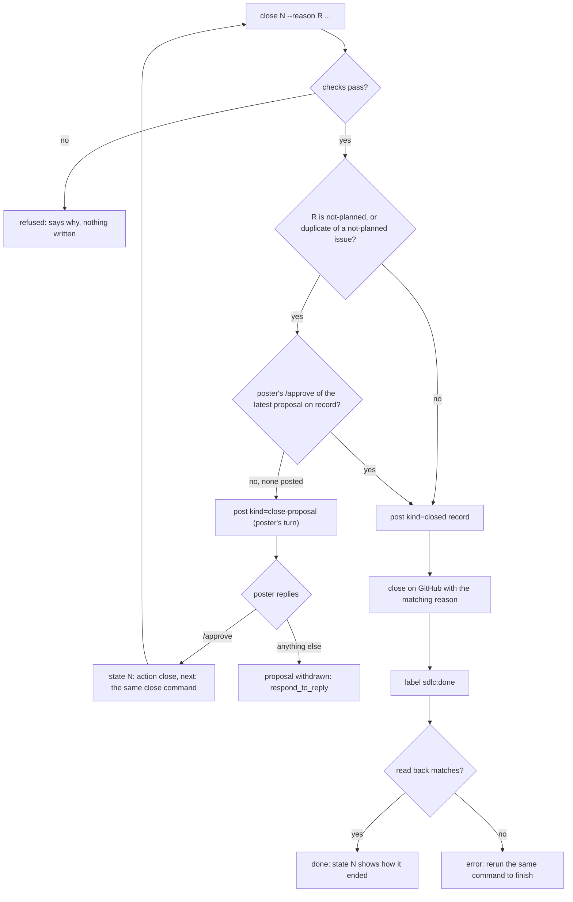

# PRD: SDLC: no verb to close an ordinary issue (fixed elsewhere, duplicate, not planned) (#378)

Approved revision 1, signed off by @jeromebanks on 2026-11-06 ([PRD](https://github.com/jeromebanks/twiddle/issues/378#issuecomment-6698294355), [sign-off](https://github.com/jeromebanks/twiddle/issues/378#issuecomment-6698318375), [approval record](https://github.com/jeromebanks/twiddle/issues/378#issuecomment-6698964541)). The text below is rev 1 exactly as approved.

## Problem

`tools/sdlc.py` can close a debt ticket (`debt-intake --verdict fixed/duplicate`), a slice or a quick change (`merge`), and an epic (`ship`). It cannot close an **ordinary issue** that is already done or no longer wanted: fixed by another epic or a commit, overtaken, or a duplicate outside the debt lane.

So an agent that finds one (#176, #153, #321 and #216 in one session) can't finish it. A bare `gh issue close` is refused by Claude Code's auto-mode classifier as an external write, no skill says when closing is allowed, and the poster ends up running a shell command for every close. The closes done by hand also leave the issue's `sdlc:*` label stale (#216, #176, #153 and #321 are closed with `sdlc:triage` still on them), and they leave no marked record of why, so `state N` can't say how the issue ended.

## Users and scenarios

- **Already fixed on `main`.** Triaging an issue like #176, an agent finds the flaky test was fixed by a commit already on `main`. It runs `sdlc.py close N --reason completed --commit <sha> --why "..." --dry-run`, sees what will happen, then runs it for real. The issue gets a marked record naming the commit, is closed as completed and labelled `sdlc:done`. The poster is asked nothing.
- **Fixed by an epic.** An issue like #216 is fixed by an epic like #243, which has shipped. `close N --reason completed --by-epic 243` checks that #243 shipped (or `--by-epic 243:M1`, that its milestone M1 did) and closes the issue the same way. Closing it automatically when an epic ships is #379's job (a wait that carries `then=close`), which runs these same checks.
- **Not planned.** An agent thinks a feature request was overtaken. It can't drop someone's request on its own: `close N --reason not-planned --why "..."` only **proposes** it, in a marked comment on the issue, and hands the move to the poster. When the poster replies `/approve`, `state N` says to run the same command again, and it closes the issue as not planned. Any other reply withdraws the proposal and triage carries on.

## Scope

- In: a new writing verb, `sdlc.py close N --reason {completed,not-planned,duplicate} --why "..." [--commit SHA | --by-epic E[:Mk] | --of M] [--dry-run]`.
- In: checks before any write, all refused with a plain message:
  - `completed` needs exactly one of `--commit SHA` (a commit on origin's default branch, read on GitHub) or `--by-epic E[:Mk]` (an epic whose last milestone, or milestone `Mk`, has a ship record on it).
  - `duplicate` needs `--of M`: an issue (not a pull request) in this repo, open or closed, and not `N` itself.
  - `not-planned` takes none of those, and closes only after the poster's recorded `/approve` of the proposal (below).
  - `--why` is required and must not contain an IP, MAC, device ID or secret: the repo is public.
- In: a marked `sdlc:v1 kind=closed` comment on the issue (reason, and the commit, epic/milestone or duplicate it names, plus the `--why`), posted **before** the close. The issue is then closed with the matching GitHub reason (`completed`, `not planned`, or as a duplicate of `M`), its `sdlc:*` label replaced by `sdlc:done`, and all of it read back.
- In: a cut-short run (the record posted, the close or the label not done) is finished by running the same command again. It never posts a second record. Different arguments from the recorded close are refused.
- In: the `not-planned` proposal: a marked `kind=close-proposal` comment saying what would be closed and why, ending with what the poster can type. It makes it the poster's turn and spends no `max_rounds`. It is never read as a triage or planning question (on an `approved` issue it doesn't route the reply to replanning), and it doesn't displace a PRD or diagnosis waiting for sign-off. An `/approve` from the issue's author or a collaborator, after the proposal and with no later marked agent revision, is the sign-off. It counts only for the close: it is never a PRD or diagnosis approval. A `/changes` or any other reply withdraws the proposal and gives the move back to the agent (`respond_to_reply`), with the issue where it was before the proposal.
- In: `duplicate --of M` where `M` was itself closed as not planned is treated like `not-planned`: it needs the poster's approval, because closing it would drop the request with nowhere left to go.
- In: `state N` reports the end of a closed issue from its record (`closed: completed by <sha>`, `by epic #E`, `duplicate of #M`, `not planned`), and shows a pending proposal and whether it is approved. An approved proposal is a new action, `close`, whose `next:` line is the `close` command to run again. `next` lists it.
- In: which issues it may close. Refused, naming the verb that owns them: a `plan:slice` or `plan:subtask` (`merge`), a `tech-debt` ticket (`debt-intake`), the debt epic (`debt-epic`), and anything being built: an epic with a created plan (`planned`, `in-progress`, `demo-review`: a person, or `ship`) or a claimed quick change (`in-progress`: its worktree and PR are `work-slice`'s). An `sdlc:escalated` issue is refused too: it is a human's. Everything else that is open may be closed: untriaged, `triage`, `needs-info`, `prd-review`, `diagnosis-review` and `approved` with no plan created yet.
- In: docs. `SDLC.md` (the verb, when an agent may close and when it must propose, and the `.claude/settings.json` rule a maintainer adds so a sub-agent may run it, written out like the one for `merge`), `docs/sdlc.html` (the new action and the close path, as it explains every action), the `triage-issue` skill (an issue found already fixed, or a duplicate, is closed with `close`; an issue that looks unwanted gets a `not-planned` proposal), and `CLAUDE.md`'s `tools/sdlc.py` row (`close` writes to GitHub, never to a speaker).

## Non-goals

- Out: closing issues automatically when an epic ships. That is #379's wait with `then=close`, which reuses this verb's checks and record. This PRD only makes the verb exist and gives `--by-epic` the shipped check #379 needs.
- Out: backfilling a record onto issues already closed by hand (#216, #176, #153, #321). They stay as they are; `state` keeps reporting them as closed. (A person can tidy their labels in the GitHub UI.)
- Out: reopening. A reopened issue is a human's, as today.
- Out: closing pull requests, or issues in other repositories.
- Out: changing how `debt-intake`, `merge` or `ship` close what they close.

## App flow



## Screens

None: a CLI verb. Its output, for the record:

```
$ uv run python tools/sdlc.py close 176 --reason completed --commit 1a2b3c4 --why "..." --dry-run
would post the close record on #176 (completed, by 1a2b3c4d5e6f)
would close #176 as completed
would label #176 sdlc:done (remove sdlc:triage)

$ uv run python tools/sdlc.py state 412
#412 Add a yodel visualizer
  state: prd-review   turn: poster   action: wait_for_poster   type: enhancement
  close proposed: not planned (rev 1), not yet approved
  next: waiting on the poster
```

## Architecture proposal

- `tools/sdlc.py`: the `close` subcommand, its checks and read-back; the two new marked kinds (`closed`, `close-proposal`) in the ledger `derive_state` reads; the new `close` action in `ALL_ACTIONS` and the `next:` line; `state`'s report of a closed issue. It should reuse what `debt-intake` already has: the commit-on-main check, the public-identifier check, the post-then-apply-then-read-back shape and the resume rule.
- The milestone/epic shipped check reads the epic's existing ship records (the same ones `state E` reads).
- Tests in `tests/test_sdlc_*.py`, offline against faked GitHub JSON, as the rest of the suite is.
- Docs: `SDLC.md`, `docs/sdlc.html`, `.agents/skills/triage-issue/SKILL.md`, `CLAUDE.md`.
- System dependencies: GitHub through `gh` only (issues, comments, labels, the compare API). No new package or service.

This touches `tools/`, a skill, `SDLC.md` and `CLAUDE.md`, all denied to the quick lane, so it is a full PRD.

## Safety class

- **Writes to GitHub, never to a speaker or Spotify**: in `CLAUDE.md`'s terms it belongs with the other `tools/sdlc.py` verbs that write to GitHub (`transition`, `debt-intake`, ...). Nothing is journalled to `logs/interventions.jsonl`, which is for speaker writes, the same as every SDLC verb.
- **`--dry-run`** resolves every check (it reads GitHub) and prints each write it would make, writing nothing.
- An agent can never close a request as not planned on its own: that needs the poster's recorded `/approve`.
- A wrong close is undone by reopening the issue on GitHub; the record stays as the trail.

## Acceptance criteria

1. `close N --reason completed --commit SHA` refuses a SHA that is not on origin's default branch, and with a commit on it posts one `kind=closed` record naming the full SHA, closes `N` as completed, leaves exactly one `sdlc:*` label (`sdlc:done`), and reads all three back.
2. `close N --reason completed --by-epic E` refuses unless epic `E`'s last milestone has a ship record; `--by-epic E:Mk` refuses unless milestone `Mk` of `E` has one. With it, it closes as in 1, the record naming `E` (and `Mk`).
3. `completed` with neither or both of `--commit` and `--by-epic`, `--of` with any reason but `duplicate`, and `--commit`/`--by-epic` with any reason but `completed` are each refused before anything is read or written.
4. `close N --reason duplicate --of M` refuses `M == N`, a pull request, and an issue that doesn't exist; with an open `M`, or one closed as completed, it closes `N` as a duplicate of `M` (GitHub's duplicate reason) with the record naming `M`.
5. `--why` is required, and a `--why` with an IP, MAC, device ID or secret in it is refused.
6. `close N --reason not-planned` with no approved proposal posts one `kind=close-proposal` comment, does not close `N`, and does not count toward `max_rounds`. `state N` then says it is the poster's turn and that a close is proposed. Posted on an `approved` issue, the poster's reply is not routed to replanning.
7. After the issue's author or a collaborator replies `/approve` to the proposal, `state N` reports action `close` and a `next:` line with the close command; running it closes `N` as not planned with a record. An `/approve` from anyone else is listed under `ignored_keywords` and does not count.
8. An `/approve` given to a close proposal neither approves nor voids an existing PRD or diagnosis revision (one waiting for sign-off is still waiting, an approved one is still approved), and an `/approve` given to a PRD never authorises a not-planned close.
9. A `/changes` or any other reply after the proposal withdraws it: `state N` shows action `respond_to_reply`, the issue's label and any pending PRD are as they were before the proposal, and `close --reason not-planned` posts a fresh proposal instead of closing.
10. `close N --reason duplicate --of M`, where `M` is closed as not planned, follows 6 and 7 (a proposal, then the poster's `/approve`).
11. `close` refuses a `plan:slice`, a `plan:subtask`, a `tech-debt` ticket, the debt epic, an `sdlc:escalated` issue, and anything being built (an epic in `planned`, `in-progress` or `demo-review`, or a claimed quick change), each message naming the verb or person that owns it.
12. Run after a cut-short close (the record posted, the close or the label missing), the same command finishes it without a second record; with different arguments it is refused; on an issue already closed and labelled as its record says, it says so and writes nothing.
13. `--dry-run` runs every check, prints each write it would make (record, proposal, close, labels) and writes nothing.
14. `state N` on an issue closed by `close` prints how it ended (completed by a commit or an epic, duplicate of `#M`, not planned) from its record.
15. `ALL_ACTIONS`, `docs/sdlc.html`, `SDLC.md`, the `triage-issue` skill and `CLAUDE.md`'s `tools/sdlc.py` row describe `close` and the `close` action; the existing test that holds `docs/sdlc.html` to `ALL_ACTIONS` passes.
16. Every test is offline (faked GitHub responses), and the full suite passes.

## Open questions

1. **Does `not-planned` need the poster's recorded `/approve` first?** Yes, always: an agent shouldn't drop someone's request on its own. That's what this PRD specifies (6 to 10). If you'd rather a collaborator's say-so is enough without a proposal, say so.
2. **Does `duplicate` need approval?** If you don't say, no: the request lives on in `M`. The one exception is a duplicate of an issue closed as not planned (10).
3. **What label does a closed issue keep?** If you don't say, `sdlc:done` for every reason, so it keeps exactly one `sdlc:*` label; GitHub's close reason and the record say how it ended.
4. **May it close an epic that has a plan?** If you don't say, no: an epic being built has slices and a branch that a close would orphan, so that stays a person's call (or `ship`'s).
5. **Should `ship` close the issues an epic says it resolves?** Your issue asks for that. If you don't say, closing at ship time is #379's job (a wait on the epic with `then=close`, recorded on the waiting issue), and this PRD adds no "resolves" list to an epic. If you also want `ship` to close issues an epic's PRD lists as resolved, say so and it joins this PRD.
6. **Flag names.** As your issue spells it, `--reason` is the close reason (`completed`, `not-planned`, `duplicate`), so the free-text explanation is `--why`. Elsewhere in `sdlc.py` (`debt-intake`, `escalate-to-full`) `--reason` is the free text; this PRD keeps your spelling on purpose.
