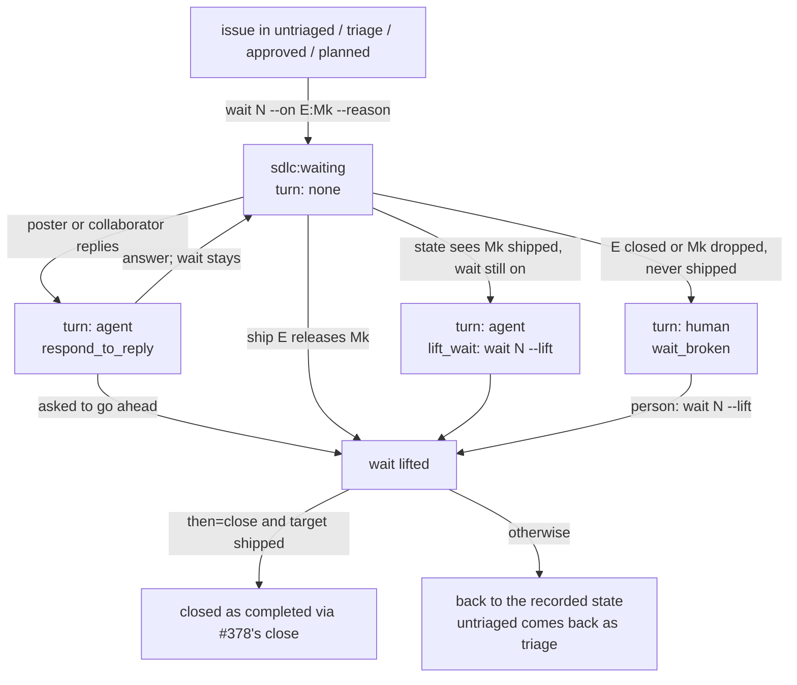

# PRD: SDLC: no 'waiting on another epic' state for ordinary issues (#379)

Approved revision 1, signed off by @jeromebanks on 2026-11-06 ([PRD](https://github.com/jeromebanks/twiddle/issues/379#issuecomment-6698304987), [sign-off](https://github.com/jeromebanks/twiddle/issues/379#issuecomment-6698350287), [approval record](https://github.com/jeromebanks/twiddle/issues/379#issuecomment-6698964472)). The text below is rev 1 exactly as approved, from *Problem* on.

## Problem

An ordinary issue whose next step can't start until another epic ships has no state that says so. It sits in whatever state it was last in, and `state N` names a next move (usually `/triage-issue N` or `/plan-issue N`) that is really a wait. The coordinator has to remember why, and that reason is lost between sessions.

Tech-debt tickets already have this: their marker carries `waits=E:Mk` (for example `waits=263:M1`), `state T` prints what they wait for, and no debt pass takes them until that milestone has shipped to `main`. Ordinary issues have nothing like it. Today's cases:

- #308 (reword the skills' speaker-write rule) is written to build on #263's bracket, and "should wait until that ships". `state 308` says `/triage-issue 308`.
- #216 should have closed when #243 shipped, and didn't: nothing recorded that its fix was #243's.
- Many triaged issues touch `tools/sdlc.py`, and work on them would collide with #263 while #263 builds.

## Users and scenarios

1. **Parking a follow-up.** The coordinator reads #308, sees it builds on #263's M2, and runs `sdlc.py wait 308 --on 263:M2 --reason "rewords the rule #263's bracket introduces"`. #308 gets `sdlc:waiting` and a marked comment that says so in plain words. `state 308` now says `turn: none`, "waiting for #263's M2 to ship to main", and `next` no longer lists it as agent work (it lists it on one "waiting:" line instead). When `ship 263` releases M2, it lifts the wait: #308 goes back to `sdlc:triage`, the lift is posted on #308, and `state 308` says `/triage-issue 308` again.
2. **An issue that only needs closing.** Had this existed when #243 was planned, #216 would have been parked with `wait 216 --on 243:M2 --then close --reason "#243's M2 fixes this"`. When #243 shipped M2, the lift would have closed #216 as completed, through #378's close verb, naming the epic, instead of leaving it open for someone to notice.
3. **The ship was missed.** An epic shipped before this existed, or `ship` was cut short after merging. `state 308` sees that #263's M2 is shipped but the wait is still on, and says so: `turn: agent`, next `uv run python tools/sdlc.py wait 308 --lift`. Rerunning is safe.
4. **The poster changes their mind.** The poster comments on #308 "actually, do this now". It's the agent's move: it answers on the issue, and lifts the wait with `wait 308 --lift --reason ...` if that is what the poster asked for.

## Scope

- In: a writing verb, `sdlc.py wait N --on E[:Mk] --reason "..." [--then close] [--dry-run]`:
  - `--on E:Mk` waits for epic E's milestone Mk to ship to `main`, recorded as `waits=E:Mk`. `--on E` waits for epic E as a whole and is recorded as `waits=E:all`, the form debt tickets already use for a whole epic: it counts as shipped once E is `done` or closed. So the marker always has debt's `E:Mk` shape, and "has it shipped" is read exactly as for a debt ticket (E's `shipped` records on GitHub). The one deliberate difference: a debt ticket stops waiting when E closes, while a wait here whose target closed without shipping is reported as broken (below), for a person to decide.
  - It refuses, saying why, when: N is a debt ticket, a slice or subtask, or the debt epic (they have their own waits); N is closed, escalated, or in a state a wait can't take (below); E is not an open feature epic (no plan, a quick change, the debt epic, closed, or `done`); Mk is not a milestone of E's latest plan (its planned milestones, created as issues or not), or has already shipped; N waits on itself; or N already waits (it says on what: one wait at a time).
  - It posts a marked `kind=wait` comment on N that records the target in the same `waits=E:Mk` form debt tickets use, the reason, the state N was in, and `then=close` if given; and it moves N's label to `sdlc:waiting`.
- In: the states a wait can take: `untriaged`, `triage`, `approved` (full lane or an approved quick brief) and `planned` (an epic planned but not yet claimed). Not the poster's states (`needs-info`, `prd-review`, `diagnosis-review`, `demo-review`), whose move is already the poster's; not `in-progress` (its slices and claims stay where they are); not `escalated` or `done`.
- In: `sdlc:waiting` is a state label like the others: exactly one `sdlc:*` label per issue still holds, so a waiting issue has `sdlc:waiting` instead of the state it left. `bootstrap-labels` creates it.
- In: `state N` on a waiting issue reports `state: waiting`, the target in the debt tickets' wording ("waiting for #263's M2 to ship to main"), the reason and the comment's link; then:
  - target not yet shipped: `turn: none`, and `next:` says what it waits for, not a step;
  - target shipped and the wait still on: `turn: agent`, action `lift_wait`, `next:` the `wait N --lift` command;
  - E closed, or its plan no longer has Mk, without Mk having shipped: `turn: human`, action `wait_broken`: a person lifts it or closes the issue;
  - an unanswered reply from the issue's author or a collaborator after the wait comment: `turn: agent`, action `respond_to_reply`; the wait stays until someone lifts it.
- In: while N waits, nothing builds it: `claim` (every lane) refuses N and any slice or subtask of N, and `next` offers none of them.
- In: `wait N --lift [--reason "..."] [--dry-run]` ends a wait, whether or not its target has shipped: it posts a marked `kind=wait-lifted` comment and puts back the state recorded at wait time (`untriaged` comes back as `triage`). A wait with `then=close` whose target shipped is instead closed by running #378's `close N --reason completed --by-epic E`, whose own checks apply. A wait lifted early, or one whose target never shipped, is never closed by the lift: it goes back to its state. Safe to rerun: a lift cut short is finished, and a lift of an issue that isn't waiting says so and writes nothing.
- In: `ship E` lifts, after it has recorded the release, every open wait on what that ship released (E:Mk, and `E:all` on the last ship), and prints each one with its new `next:`; `ship E --dry-run` lists the waits it would lift. A lift that fails does not undo or fail the ship: the ship's output says so, and `state N` then shows `lift_wait`.
- In: `next` leaves waiting issues out of agent work and lists them on one line ("waiting: #308 on #263's M2; ..."), so they stay visible.
- In: this is a full-lane PRD, not a quick brief, because it changes `tools/` and `.sdlc/`.
- In: `--then close` is refused, saying why, until #378's `close` verb is on `main`, so everything else here can ship without waiting for #378.
- In: `SDLC.md` (the state diagram, "Whose move", and the verb), `docs/sdlc.html`, `CLAUDE.md`'s `tools/sdlc.py` row, and the `triage-issue` skill (when to park an issue with `wait` rather than triage it now) say what this does.

## Non-goals

- Out: the close verb itself. `then=close` uses #378's `close`; it is not built here.
- Out: waiting on anything other than a milestone or an epic shipping to `main`: an issue closing, a PR merging, a date, or a person (`demo-request` and `debt-request` cover a person).
- Out: changing how debt tickets wait. Their `waits=` keeps its meaning; this reuses its form and wording, and its reading of "shipped".
- Out: more than one wait per issue, or a wait on several epics at once.
- Out: waiting an epic that is being built (`in-progress`), or holding back its slices.
- Out: lifting automatically from `state` (it is read-only and stays so) or from a watcher.
- Out: any speaker write.

## App flow



## Screens

No TUI. The `state` output for a waiting issue:

```
#308 SDLC skills: reword the speaker-write rule to the bracket (follow-up to #263)
  state: waiting   turn: none   action: none   type: enhancement
  waiting for #263's M2 to ship to main (since 2026-11-06, from triage): rewords the rule #263's bracket introduces
  latest revision: none   approved: no   rounds: 0/5
  next: nothing yet: #308 waits for #263's M2 to ship to main (https://github.com/.../issues/308#issuecomment-...)
```

and in `next`:

```
waiting: #308 on #263's M2; #350 on #263
```

## Architecture proposal

All in the SDLC tooling; nothing under `src/twiddle/` changes.

- `tools/sdlc.py`:
  - the ledger reads `kind=wait` and `kind=wait-lifted` markers (only trusted authors', as for every marker) into the issue's state: the target, the recorded state, `then`, the reason, the comment;
  - `derive_state` gives `waiting` its turn and action, from the target epic's state read the way `debt_waiting_for` reads it (the target epic's `shipped` records; `wait_target` for the wording);
  - a new `wait` command (place and `--lift`), `ship`'s lift step, `next`'s "waiting:" line;
  - the `then=close` lift calls #378's close verb's logic, not a second copy of it.
- `.sdlc/config.json`: `sdlc:waiting` joins the state labels (`bootstrap-labels` creates it).
- Docs: `SDLC.md`, `docs/sdlc.html`, `CLAUDE.md`'s row; skill `triage-issue`.
- Dependencies: GitHub through `gh`, as today; no new package or service. #378 for `then=close`.

## Safety class

**Writes to GitHub only, never to a speaker or Spotify.** `wait` and `wait --lift` post one marked comment and move one `sdlc:*` label (and, for a `then=close` lift, close the issue through #378's verb); `ship`'s lift does the same for each wait it lifts. All of them take `--dry-run`, which prints what they would post and change and writes nothing. `state` and `next` stay read-only. Nothing is journalled to `logs/interventions.jsonl`, which is for speaker writes: the marked comments on the issue are the record. The tests use recorded GitHub JSON and touch no network.

## Acceptance criteria

1. `wait N --on E:Mk --reason R` on an issue in `triage` posts one marked `kind=wait` comment carrying `waits=E:Mk`, the reason and `from=triage`, and leaves N with `sdlc:waiting` as its only `sdlc:*` label; `--dry-run` prints the comment and the label change and writes nothing.
2. `wait` refuses, naming the reason and writing nothing, for each of: N a debt ticket, a slice, a subtask or the debt epic; N closed or escalated; N in `needs-info`, `prd-review`, `diagnosis-review`, `demo-review`, `in-progress` or `done`; N already waiting; E equal to N; E not an open feature epic with a plan; Mk not in E's latest plan; Mk already shipped.
3. `--on E` with no milestone is recorded as `waits=E:all` and counts as shipped once E is `done` or closed after shipping, read by the same logic as a debt ticket's `waits=E:all`; `state` words it "#E".
4. `state N` on a waiting issue whose target hasn't shipped reports `state: waiting`, `turn: none`, the target in the debt tickets' wording, the reason and the wait comment's link, and its `next:` names no step to run.
5. `state N` on a waiting issue whose target has shipped (the wait not lifted) reports `turn: agent`, action `lift_wait`, and `next:` is `uv run python tools/sdlc.py wait N --lift`.
6. `state N` reports `turn: human`, action `wait_broken`, when E is closed or its latest plan no longer has Mk, and Mk never shipped.
7. A reply by the issue's author or a collaborator after the wait comment makes `state N` report `turn: agent`, action `respond_to_reply`, with the label still `sdlc:waiting`; a note from the agent answering it puts it back to `turn: none`.
8. `wait N --lift` posts a marked `kind=wait-lifted` comment and restores the recorded state's label (`triage` for a wait placed on an untriaged issue); `state N` then gives that state's usual next move. Run on an issue that isn't waiting, it says so and writes nothing; run again after a lift cut short between the comment and the label, it finishes the lift.
9. A wait with `then=close` whose target has shipped is, on lift, closed as completed by #378's `close N --reason completed --by-epic E`; lifted before its target shipped, or after `wait_broken`, it goes back to its recorded state and stays open. Until #378's `close` is on `main`, `wait --then close` is refused with a message naming #378.
10. `ship E` that releases Mk lifts every open wait on E:Mk (and, on E's last ship, every wait on `E:all`), and prints each lifted issue with its new `next:`; `ship E --dry-run` lists the waits it would lift and writes nothing; a failed lift is reported and does not fail the ship.
11. While N waits, `claim` in every lane refuses N and every slice or subtask of N, and `next` offers none of them.
12. `next` lists no waiting issue as agent work unless its state is `lift_wait`, `respond_to_reply` or `wait_broken` (then as for any issue whose turn it is), and prints the others on one "waiting:" line.
13. A `kind=wait` marker from an account that can't write to the repo is ignored, as for every marker.
14. Debt tickets' waits behave exactly as before (the existing debt-lane tests still pass unchanged).
15. `SDLC.md`, `docs/sdlc.html`, `CLAUDE.md`'s `tools/sdlc.py` row and the `triage-issue` skill describe `sdlc:waiting`, `wait` and `wait --lift`.
16. Every test is offline.

## Open questions

1. **Is `sdlc:waiting` a state (replacing the issue's state label) or a flag beside it?** If you don't say, I'll assume a state, as you wrote it: it keeps "one `sdlc:*` label per issue", and the wait comment records the state to go back to.
2. **Which states may wait?** If you don't say: `untriaged`, `triage`, `approved` and `planned` (with `claim` refusing its slices while it waits), and not an epic `in-progress`, whose slices and claims would be left hanging.
3. **Does `then=close` need the poster's `/approve`?** #378 asks this for `not-planned`. If you don't say: no, because the lift closes only as `completed`, by an epic that has shipped, and only through #378's own checks; a `then=close` wait never closes as `not-planned`.

