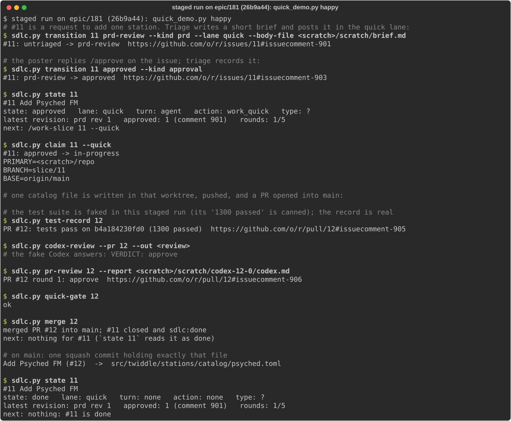
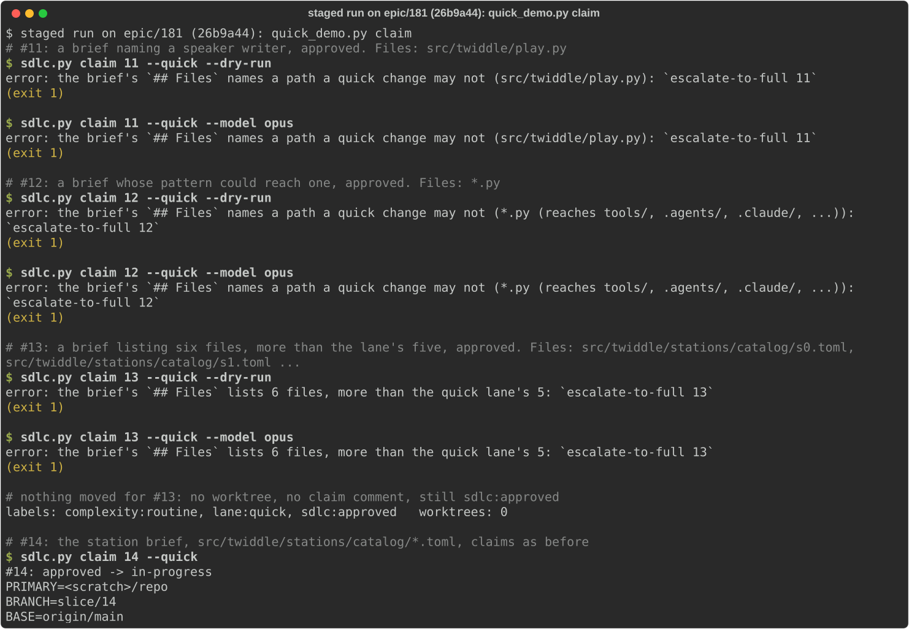
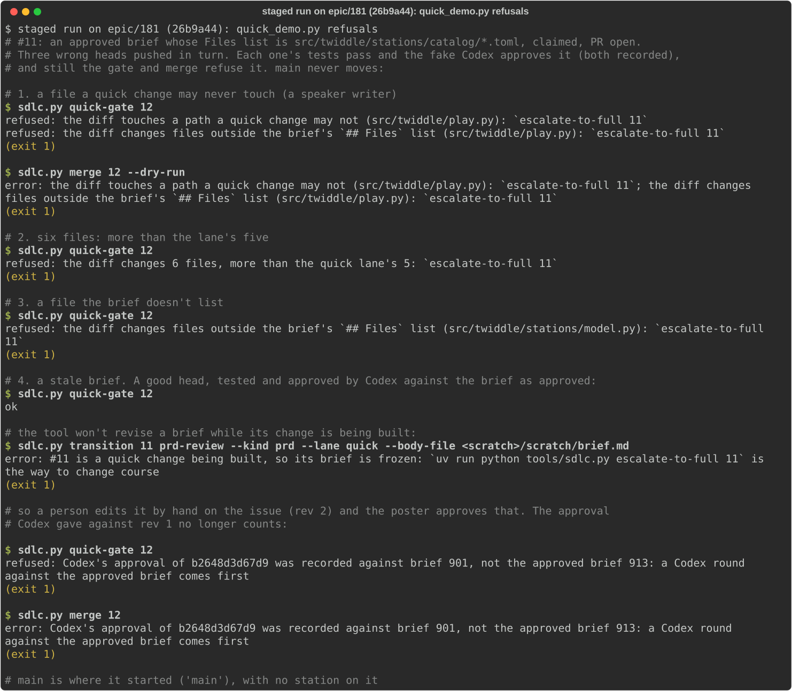
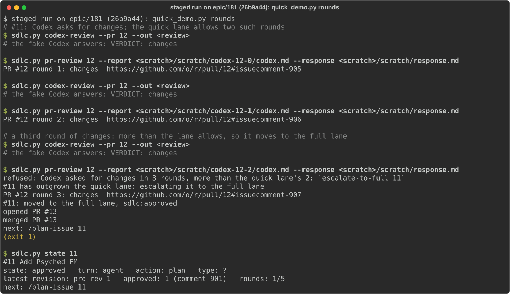
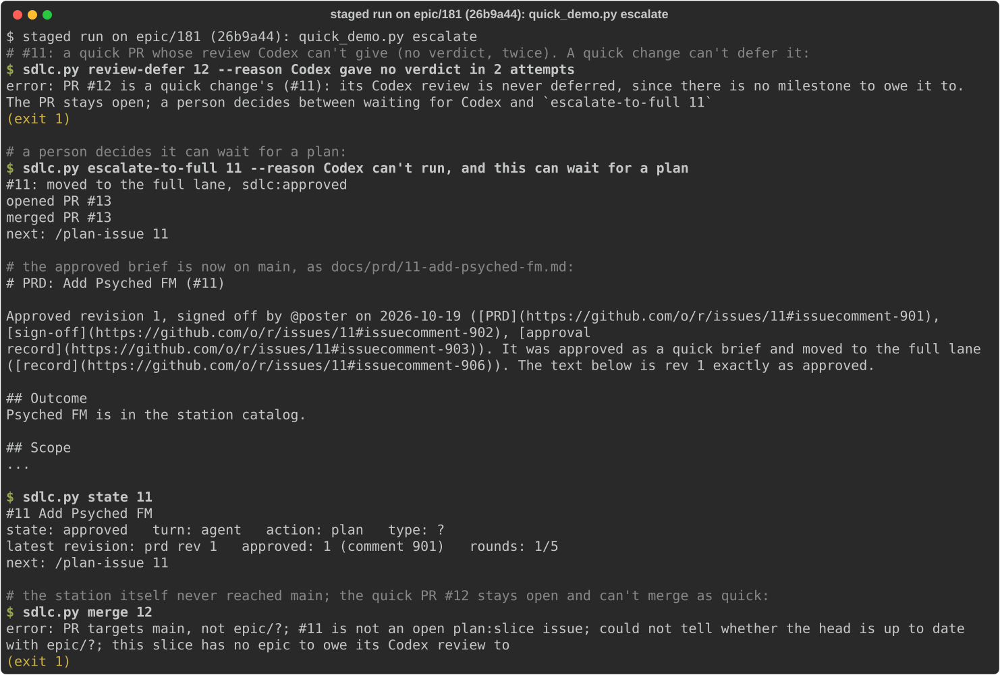
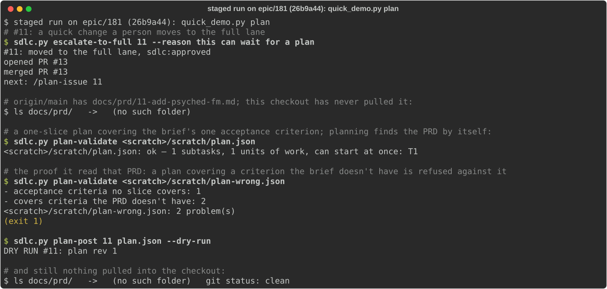
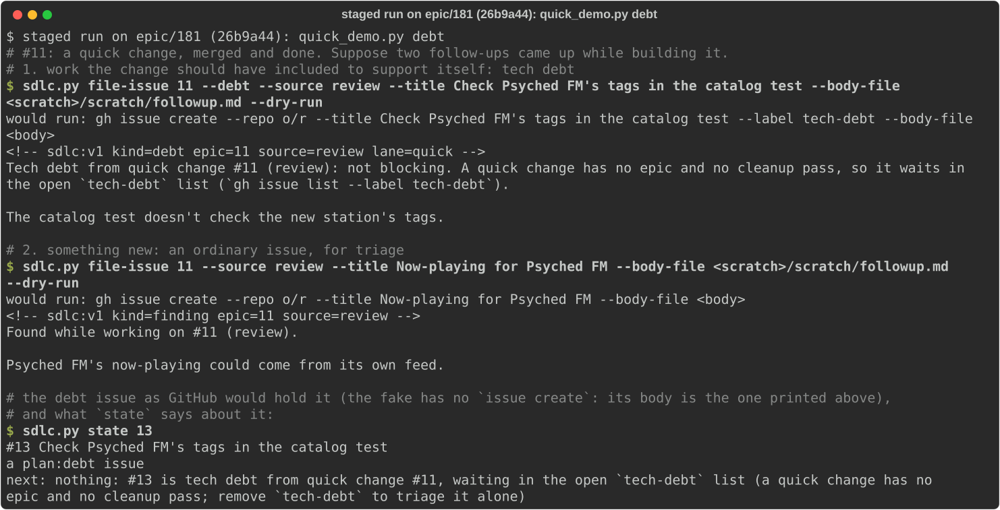
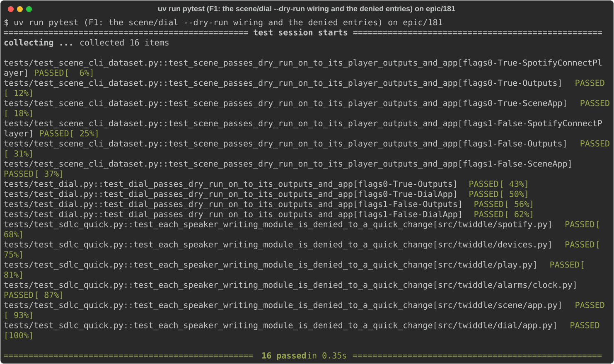
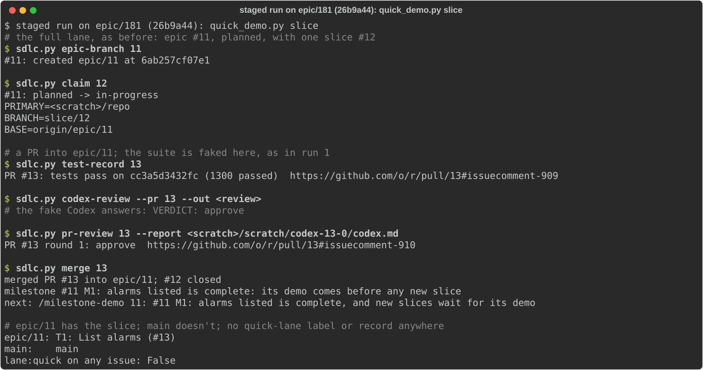
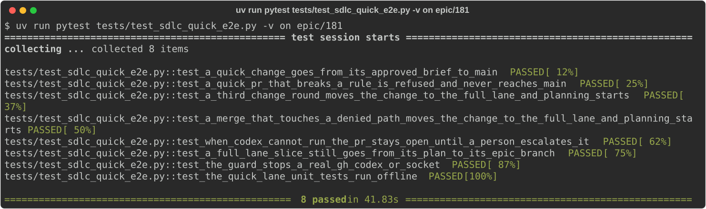

# #181 M1: A quick change goes from approved brief to merged

Demo of epic #181 (the quick lane) at `epic/181` (26b9a44f3577), with `main` (701b49e7a39e) as the "before".
[The milestone's first Codex review](https://github.com/jeromebanks/twiddle/issues/181#issuecomment-6297592985) asked for
changes before any demo was posted; plan rev 7 added the fix slices F1-F4, all merged, and this is the first demo.

**This is a staged run.** Until this milestone ships, `main`'s `tools/sdlc.py` doesn't know the quick lane, and the
`lane:quick` label exists only in `epic/181`'s `.sdlc/config.json`. So the real quick change the poster cares about,
#182 (adding the Psyched! Radio station), can't go through the lane yet. It will be the **first real quick change
after ship**, once `uv run python tools/sdlc.py bootstrap-labels` has been run on `main` to create `lane:quick`.

What was run instead:

- Every `sdlc.py ...` line in the staged pictures is the real `tools/sdlc.main` from a detached worktree of
  `epic/181` at 26b9a44.
- It runs against a throwaway git repo with a bare origin. GitHub is `tests/test_sdlc_quick_e2e.py`'s `FakeGitHub`
  (only `sdlc.gh` is replaced; it answers in gh's own shapes, and its `github.com/o/r/...` links aren't real).
- Codex is `tests/fake_codex.py`'s scripted `codex` on `PATH`, with its verdict written in the picture.
- The full test suite is faked for `test-record`: "1300 passed" is canned. The record it writes is real.
- In the `plan` run (F2), `sdlc.ROOT` is pointed at the scratch repo, as F2's own tests do, so planning looks for the
  PRD in that repo's working tree and its `origin/main`, exactly as it would in the real checkout.
- In the `debt` run (F3), the fake GitHub has no `issue create`, so the debt issue `state` reads was seeded with the
  exact body `file-issue --debt --dry-run` printed just above it. Everything else in that run is the real command.
- `gh` and `codex` sentinels sit first on `PATH`, so a real one would have failed the run. None was reached.
- No speaker, Spotify, real issue or real PR was touched. Every step is read-only for the real world, so no
  `demo-request` was needed.

The two pytest pictures are real runs on the `epic/181` worktree. The script is in the appendix below. It ran from
the `epic/181` checkout as `uv run python quick_demo.py <scenario>`.

## What was built

| Slice | What | PR |
|---|---|---|
| #186 T1 | The quick lane in the ledger: `--lane quick` on a brief, `lane:` in `state`, `next: /work-slice N --quick` | #195 |
| #187 T2 | `claim N --quick` (worktree from `origin/main`, freezes the brief), `slice-check`, `slice-status` | #198 |
| #190 T3.1 | The quick merge gate: `quick` limits in `.sdlc/config.json`, the rules, a read-only `quick-gate` | #199 |
| #191 T3.2 | `merge` for a quick PR: squash into `main`, close, `sdlc:done`, a record on the issue | #203 |
| #188 T4 | `codex-review --pr` reviews a quick PR against the approved brief (`Brief:` line, `brief=` in the record); no `review-defer` | #204 |
| #192 T5.1 | `escalate-to-full N`, plus the automatic triggers (a third change round; a denied path, size or unlisted file at `merge`) | #207 |
| #189 T5.2 | `commit-prd N`: the escalated brief goes to `docs/prd/N-*.md` through a docs-only PR | #205 |
| #193 T6 | Skills and docs: `triage-issue` §"Quick lane", `work-slice` §"A quick change (`--quick`)", `SDLC.md` §"The quick lane", `docs/sdlc.html` | #211 |
| #194 T7 | `tests/test_sdlc_quick_e2e.py`: the whole lane offline, with a guard against a real gh, codex or socket | #212 |
| #218 F1 | Tests pinning `scene --dry-run` / `dial --dry-run` reaching their player, outputs and app, and each speaker-writing module denied to a quick change (config unchanged, per the poster's decision) | #221 |
| #217 F2 | `plan-validate` / `plan-post` / `plan-create` read a merged PRD from `origin/main` when the checkout hasn't pulled it (one bounded fetch) | #222 |
| #220 F3 | A follow-up is debt by what it is; `file-issue --debt` on a quick change names the open `tech-debt` list, and `state` on that debt says where it waits | #224 |
| #219 F4 | `claim --quick` checks the brief's `## Files` (denied paths, patterns that could reach one, more than 5) and, on `--resume`, the branch's and worktree's diff | #226 |

## The steps, as run

All were run by the agent. None writes to anything real.

1. **An approved brief goes to merged** (`quick_demo.py happy`): `transition N prd-review --kind prd --lane quick`,
   the poster's `/approve` (`transition N approved`), `state`, `claim N --quick`, one catalog file pushed and a PR into
   `main`, `test-record`, a Codex round and `pr-review`, `quick-gate`, `merge`, `state`. The result is one squash commit
   on `main` holding exactly `src/twiddle/stations/catalog/psyched.toml`, and the issue closed and `done`.

   

2. **Refused at claim** (`quick_demo.py claim`, F4): three approved briefs, each `claim --quick --dry-run` and then
   `claim --quick`: `src/twiddle/play.py` (a denied path), `*.py` (a pattern reaching `tools/`, `.agents/`, ...), and
   six catalog files (more than `quick.max_files`, 5). Each is refused with `escalate-to-full N`, and the last issue is
   still `sdlc:approved` with no worktree. A brief of `src/twiddle/stations/catalog/*.toml` claims as before.
   The same refusal from the slice's own fixture, outside the staged repo:
   `uv run python tools/sdlc.py claim 12 --quick --dry-run --from-file tests/fixtures/quick_claim/denied_path.json`
   prints ``error: the brief's `## Files` names a path a quick change may not (src/twiddle/play.py): `escalate-to-full 12` ``.

   

3. **The merge gate's refusals** (`quick_demo.py refusals`, `quick_demo.py rounds`):
   - three wrong heads, each with a passing test record and Codex's approval: a denied path (`src/twiddle/play.py`),
     six files (the limit is 5), a file outside the brief's `## Files`. `quick-gate` and `merge --dry-run` refuse;
   - the stale brief: `transition` refuses to revise a brief being built ("its brief is frozen"). A hand-edited rev 2,
     approved, voids the Codex approval recorded against rev 1, and `quick-gate` and `merge` refuse;
   - the rounds overflow: two rounds of Codex asking for changes are allowed. On the third, `pr-review` escalates to
     the full lane on its own (and commits the brief as a PRD), and `state` says `/plan-issue N`.

   

   

4. **`escalate-to-full`, then planning** (`quick_demo.py escalate`, `quick_demo.py plan`, F2): Codex gives no verdict
   twice; `review-defer` is refused for a quick PR; a person runs `escalate-to-full N --reason ...`. The brief lands on
   `main` as `docs/prd/N-add-psyched-fm.md` (rev 1 exactly as approved, with links to the brief, sign-off and lane
   record), `state` says `/plan-issue N`, and the quick PR stays open and can't merge as quick (the noisy `epic/?` in
   that refusal is #213). Then, in a checkout that never pulled (`docs/prd/` absent): `plan-validate` on a plan
   covering criterion 1 is ok; one covering criterion 2 is refused with "covers criteria the PRD doesn't have: 2"
   (so the PRD on `origin/main` was read); `plan-post --dry-run` drafts plan rev 1; and the checkout is still clean,
   with no `docs/prd/`.

   

   

5. **Follow-ups** (`quick_demo.py debt`, F3): after a quick change merged, `file-issue N --debt --source review
   --dry-run` prints a `tech-debt` issue whose marker records `lane=quick` and whose lead says it "waits in the open
   `tech-debt` list"; `file-issue N --source review --dry-run` (no `--debt`) prints an ordinary finding for triage; and
   `state` on the debt issue says "tech debt from quick change #N, waiting in the open `tech-debt` list".

   

6. **F1's tests** on `epic/181`: `uv run pytest -v` of
   `tests/test_scene_cli_dataset.py::test_scene_passes_dry_run_on_to_its_player_outputs_and_app`,
   `tests/test_dial.py::test_dial_passes_dry_run_on_to_its_outputs_and_app` and
   `tests/test_sdlc_quick.py::test_each_speaker_writing_module_is_denied_to_a_quick_change`: 16 passed.

   

7. **A normal slice still merges into its epic** (`quick_demo.py slice`): `epic-branch`, `claim` (base
   `origin/epic/N`), `test-record`, a Codex round, `merge`. It lands on `epic/N`, not `main`, the milestone demo is
   next, and there's no `lane:quick` label or quick record anywhere.

   

8. **The milestone's own demo step**: `uv run pytest tests/test_sdlc_quick_e2e.py -v` on `epic/181`: 8 passed.

   

## What changed from the plan

- The milestone's first Codex review asked for changes; plan rev 7 added F1-F4, and all four are merged (13 slices).
- F1 follows [the poster's decision](https://github.com/jeromebanks/twiddle/issues/181#issuecomment-6300088821):
  `scene/cli.py` and `dial/cli.py` are not denied paths; tests pin their `--dry-run` wiring instead.
- The poster's follow-up rule (debt is work the change needed to support itself, anything else an ordinary issue for
  triage, in either lane) is now implemented by F3. The open point about follow-ups is resolved.
- F4 added `claim --from-file` (with `--quick --dry-run` only) so the refusal can be shown from a fixture.
- **The milestone review.** T6 and F1 (routine) skipped their own Codex review and were reviewed with the milestone.
  `sync 181` found `epic/181` already containing `main` and the suite passing (6614). Codex (round 2 of the
  milestone review, on 26b9a44) approved, with two non-blocking notes: the triage-issue skill still says the quick
  rules are checked only at merge (filed as #230), and the round budget shown for a quick PR (#208, already filed).

## Known gaps

- `lane:quick` must be created on `main` after ship: `uv run python tools/sdlc.py bootstrap-labels`.
- No real quick change has run yet. #182 (Psyched! Radio) is the first.
- A known process issue, separate from this lane: #216, plan review of an epic's amendment reads `main`, not `epic/N`.
- Open tech debt from building this: #196, #197, #200, #201, #202, #206, #208, #210, #213, #214, #223, #225, #227,
  #229, #230.

## Appendix: the staged-run script (`quick_demo.py`)

```python
"""A staged run of the quick lane, for #181 M1's demo. Run from a checkout of epic/181:

    uv run python quick_demo.py happy|refusals|escalate|slice

Every `sdlc.py` line below is the real `tools/sdlc.main` command, run against a throwaway git repo with a bare
origin. GitHub is tests/test_sdlc_quick_e2e.py's FakeGitHub (the only thing replaced is `sdlc.gh`), Codex is
tests/fake_codex.py's scripted `codex` on PATH, and the test suite is faked for `test-record`. Nothing here
reaches the network, the real repository, a real Codex, a speaker or Spotify.
"""
import io
import json
import os
import re
import subprocess
import sys
import tempfile
from pathlib import Path

sys.path.insert(0, os.getcwd())                       # the epic/181 checkout's tools/ and tests/

from _pytest.monkeypatch import MonkeyPatch           # noqa: E402

from tests import test_sdlc_quick_e2e as e2e           # noqa: E402
from tests.fake_codex import APPROVES, NO_VERDICT      # noqa: E402
from tools import sdlc                                 # noqa: E402

OUT = sys.__stdout__
TMP = Path(tempfile.mkdtemp(prefix="quickdemo-")).resolve()
STATION = "src/twiddle/stations/catalog/psyched.toml"
STATION_TOML = ('key = "psyched"\nname = "Psyched FM"\nstream = "https://example.invalid/psyched.mp3"\n'
                'tags = ["psych", "rock"]\n')


def say(text=""):
    OUT.write(text + "\n")
    OUT.flush()


def note(text):
    say(f"\033[2m# {text}\033[0m")


def clean(text):
    return text.replace(str(TMP), "<scratch>")


class Capture:
    """capsys, outside pytest: sys.stdout/err swapped for buffers that readouterr() drains."""

    class Pair:
        def __init__(self, out, err):
            self.out, self.err = out, err

    def __init__(self):
        self.o, self.e = io.StringIO(), io.StringIO()
        sys.stdout, sys.stderr = self.o, self.e

    def readouterr(self):
        r = self.Pair(self.o.getvalue(), self.e.getvalue())
        self.o.seek(0), self.o.truncate(), self.e.seek(0), self.e.truncate()
        return r


def git(*args, cwd):
    return subprocess.run(["git", *args], cwd=cwd, check=True, capture_output=True, text=True).stdout.strip()


def make_repo(mp):
    """tests/test_sdlc_quick.py's `repo` fixture: a scratch repo and its bare origin."""
    origin, root = TMP / "origin.git", TMP / "repo"
    git("init", "-q", "--bare", "-b", "main", str(origin), cwd=TMP)
    git("init", "-q", "-b", "main", str(root), cwd=TMP)
    for k, v in (("user.name", "demo"), ("user.email", "demo@example.invalid")):
        git("config", k, v, cwd=root)
    (root / "code.py").write_text("x = 1\n")
    (root / ".gitignore").write_text(".worktrees/\n")
    git("add", ".", cwd=root)
    git("commit", "-q", "-m", "main", cwd=root)
    git("remote", "add", "origin", str(origin), cwd=root)
    git("push", "-q", "origin", "main", cwd=root)
    mp.chdir(root)
    return root


class Demo(e2e.Lane):
    def show(self, *argv, cwd=None):
        """Run one sdlc.py command and print it, as a terminal would."""
        say(f"\033[1;32m$\033[0m \033[1msdlc.py {clean(' '.join(map(str, argv)))}\033[0m")
        code, out, err = self.run(*argv, cwd=cwd)
        text = clean((err + out if code else out + err).rstrip())   # a refusal is printed before what follows it
        if text:
            say(text)
        if code:
            say(f"\033[33m(exit {code})\033[0m")
        say()
        return code, out, err

    def gate(self, pr):
        """quick-gate, showing only its refusal lines."""
        say(f"\033[1;32m$\033[0m \033[1msdlc.py quick-gate {pr}\033[0m")
        code, out, err = self.run("quick-gate", pr)
        for line in (out + err).splitlines():
            if line.startswith("refused") or line == "ok":
                say(clean(line))
        say(f"\033[33m(exit {code})\033[0m" if code else "")
        if code:
            say()

    def codex_round(self, pr, wt, step, response=None):
        code, report, out = self.codex(pr, wt, step)
        verdict = report.read_text().strip().splitlines()[-1] if report.exists() else "?"
        say(f"\033[1;32m$\033[0m \033[1msdlc.py codex-review --pr {pr} --out <review>\033[0m")
        note(f"the fake Codex answers: {verdict}")
        say()
        args = ["pr-review", pr, "--report", report]
        if response:
            (self.scratch / "response.md").write_text(response)
            args += ["--response", self.scratch / "response.md"]
        return self.show(*args, cwd=wt)


def setup():
    mp = MonkeyPatch()
    mp.setenv("HOME", str(TMP / "home"))              # fake_codex's guard: never the real ~/.codex
    mp.delenv("CODEX_HOME", raising=False)
    (TMP / "home" / ".codex").mkdir(parents=True)
    bin_ = TMP / "sentinel-bin"                     # a real gh or codex, if anything reached one, only logs
    bin_.mkdir()
    for name in ("gh", "codex"):
        (bin_ / name).write_text(f'#!/bin/sh\necho "{name} $*" >> "{TMP}/sentinel.log"\nexit 97\n')
        (bin_ / name).chmod(0o755)
    mp.setenv("PATH", f"{bin_}{os.pathsep}{os.environ['PATH']}")
    root = make_repo(mp)
    return Demo(TMP, mp, Capture(), root)


def happy(d):
    gh = d.gh
    n = gh.new_issue("Add Psyched FM", "Please add Psyched FM.", [e2e.ROUTINE])
    note(f"#{n} is a request to add one station. Triage writes a short brief and posts it in the quick lane:")
    f = d.scratch / "brief.md"
    f.write_text(d.brief(["src/twiddle/stations/catalog/*.toml"]))
    d.show("transition", n, "prd-review", "--kind", "prd", "--lane", "quick", "--body-file", f)
    note("the poster replies /approve on the issue; triage records it:")
    gh.say(n, e2e.POSTER, "/approve")
    d.show("transition", n, "approved", "--kind", "approval")
    d.show("state", n)
    out = d.ok("claim", n, "--quick", "--model", "opus")
    say(f"\033[1;32m$\033[0m \033[1msdlc.py claim {n} --quick\033[0m")
    say("\n".join(clean(l) for l in out.splitlines() if not l.startswith("WORKTREE=")))
    say()
    wt = Path(re.search(r"^WORKTREE=(.+)$", out, re.M).group(1))
    note("one catalog file is written in that worktree, pushed, and a PR opened into main:")
    d.commit(wt, n, {STATION: STATION_TOML}, "Add Psyched FM")
    pr = d.open_pr(n)
    say()
    note("the test suite is faked in this staged run (its '1300 passed' is canned); the record is real")
    d.show("test-record", pr, cwd=wt)
    d.codex_round(pr, wt, APPROVES)
    d.show("quick-gate", pr)
    d.show("merge", pr)
    note("on main: one squash commit holding exactly that file")
    say(clean(gh.origin_git("log", "--format=%s", "-1", "main")) + "  ->  "
        + gh.origin_git("diff", "--name-only", "main^", "main"))
    say()
    d.show("state", n)


def refusals(d):
    gh = d.gh
    n = gh.new_issue("Add Psyched FM", "Please add Psyched FM.", [e2e.ROUTINE])
    f = d.scratch / "brief.md"
    f.write_text(d.brief(["src/twiddle/stations/catalog/*.toml"]))
    d.ok("transition", n, "prd-review", "--kind", "prd", "--lane", "quick", "--body-file", f)
    d.approve(n)
    wt = d.claim(n)
    note(f"#{n}: an approved brief whose Files list is src/twiddle/stations/catalog/*.toml, claimed, PR open.")
    note("Three wrong heads pushed in turn. Each one's tests pass and the fake Codex approves it (both recorded),")
    note("and still the gate and merge refuse it. main never moves:")
    say()
    bad = [("1. a file a quick change may never touch (a speaker writer)",
            {STATION: STATION_TOML, "src/twiddle/play.py": "# writes to a speaker\n"}),
           ("2. six files: more than the lane's five",
            {f"src/twiddle/stations/catalog/s{i}.toml": f"key = 's{i}'\n" for i in range(6)}),
           ("3. a file the brief doesn't list",
            {STATION: STATION_TOML, "src/twiddle/stations/model.py": "# a model change\n"})]
    pr = None
    for label, files in bad:
        note(label)
        d.commit(wt, n, files, "Add Psyched FM", fresh=True)
        pr = pr or d.open_pr(n)
        d.ok("test-record", pr, cwd=wt)
        d.review(pr, wt, APPROVES)
        d.gate(pr)
        if label.startswith("1."):
            d.show("merge", pr, "--dry-run")
    note("4. a stale brief. A good head, tested and approved by Codex against the brief as approved:")
    d.commit(wt, n, {STATION: STATION_TOML}, "Add Psyched FM", fresh=True)
    d.ok("test-record", pr, cwd=wt)
    d.review(pr, wt, APPROVES)
    d.gate(pr)
    note("the tool won't revise a brief while its change is being built:")
    d.show("transition", n, "prd-review", "--kind", "prd", "--lane", "quick", "--body-file", f)
    note("so a person edits it by hand on the issue (rev 2) and the poster approves that. The approval")
    note("Codex gave against rev 1 no longer counts:")
    rev = d.brief(["src/twiddle/stations/catalog/*.toml"], "Psyched FM, tagged psych.")
    gh.say(n, e2e.OWNER, sdlc.render_comment("prd", 2, rev, d.cfg, lane="quick"))
    gh.say(n, e2e.POSTER, "/approve")
    gh.say(n, e2e.OWNER, sdlc.render_comment("approval", 2, "PRD rev 2 approved by @poster.", d.cfg, by=e2e.POSTER,
                                             via="comment"))
    say()
    d.gate(pr)
    d.show("merge", pr)
    note(f"main is where it started ({gh.origin_git('log', '--format=%s', '-1', 'main')!r}), with no station on it")


def rounds(d):
    """The fifth refusal: a third round of Codex asking for changes leaves the quick lane."""
    n = d.quick_issue()
    wt = d.claim(n)
    d.commit(wt, n, {STATION: STATION_TOML}, "Add Psyched FM")
    pr = d.open_pr(n)
    changes = {"out": "1. **blocking** — the stream URL isn't the station's own.\n\nVERDICT: changes\n"}
    note(f"#{n}: Codex asks for changes; the quick lane allows two such rounds")
    for rnd in (1, 2):
        d.codex_round(pr, wt, changes, response="1. Accepted: fixed in the next commit.")
        d.commit(wt, n, {STATION: STATION_TOML + f"# round {rnd}\n"}, "Fix the stream")
    note("a third round of changes: more than the lane allows, so it moves to the full lane")
    d.codex_round(pr, wt, changes, response="1. Accepted.")
    d.show("state", n)


def escalate(d):
    gh = d.gh
    n = d.quick_issue()
    wt = d.claim(n)
    d.commit(wt, n, {STATION: STATION_TOML}, "Add Psyched FM")
    pr = d.open_pr(n)
    d.ok("test-record", pr, cwd=wt)
    note(f"#{n}: a quick PR whose review Codex can't give (no verdict, twice). A quick change can't defer it:")
    d.codex(pr, wt, NO_VERDICT, NO_VERDICT)
    d.show("review-defer", pr, "--reason", "Codex gave no verdict in 2 attempts", cwd=wt)
    note("a person decides it can wait for a plan:")
    d.show("escalate-to-full", n, "--reason", "Codex can't run, and this can wait for a plan")
    (path,) = [p for p in gh.origin_git("ls-tree", "-r", "--name-only", "main").splitlines() if p.startswith("docs/prd/")]
    note(f"the approved brief is now on main, as {path}:")
    say("\n".join(clean(gh.origin_git("show", f"main:{path}")).splitlines()[:8]))
    say("...")
    say()
    d.show("state", n)
    note(f"the station itself never reached main; the quick PR #{pr} stays open and can't merge as quick:")
    d.show("merge", pr)


def slice_(d):
    gh = d.gh
    marker = lambda kind, rev=None, **kw: sdlc.marker(kind, rev, **kw) + "\ntext"   # noqa: E731
    epic = gh.new_issue("Alarm manager", "Manage alarms.", ["sdlc:planned"])
    for author, body in [(e2e.OWNER, marker("prd", 1)), (e2e.POSTER, "/approve"),
                         (e2e.OWNER, marker("approval", 1, by=e2e.POSTER, via="comment")),
                         (e2e.OWNER, marker("plan", 1)),
                         (e2e.OWNER, marker("plan-review", 1, verdict="approve", round="1")),
                         (e2e.OWNER, marker("plan-created", 1))]:
        gh.say(epic, author, body)
    sections = "\n\n".join(f"## {s}\n{s.lower()}" for s in sdlc.LEAF_SECTIONS.values())
    s = gh.new_issue(f"#{epic} T1: List alarms", sdlc.marker("slice", None, epic=str(epic), key="T1")
                     + f"\nEpic: #{epic}\n\n{sections}", ["plan:slice", "complexity:judgment"], author=e2e.OWNER,
                     milestone=f"#{epic} M1: alarms listed")
    note(f"the full lane, as before: epic #{epic}, planned, with one slice #{s}")
    d.show("epic-branch", epic)
    out = d.ok("claim", s, "--model", "opus")
    say(f"\033[1;32m$\033[0m \033[1msdlc.py claim {s}\033[0m")
    say("\n".join(clean(l) for l in out.splitlines() if not l.startswith("WORKTREE=")))
    say()
    wt = Path(re.search(r"^WORKTREE=(.+)$", out, re.M).group(1))
    d.commit(wt, s, {"alarms.py": "ALARMS = []\n"}, "List alarms")
    pr = d.open_pr(s, base=f"epic/{epic}", title="T1: List alarms")
    note(f"a PR into epic/{epic}; the suite is faked here, as in run 1")
    d.show("test-record", pr, cwd=wt)
    d.codex_round(pr, wt, APPROVES)
    d.show("merge", pr)
    note(f"epic/{epic} has the slice; main doesn't; no quick-lane label or record anywhere")
    say(f"epic/{epic}: {gh.origin_git('log', '--format=%s', '-1', f'epic/{epic}')}")
    say(f"main:    {gh.origin_git('log', '--format=%s', '-1', 'main')}")
    say(f"lane:quick on any issue: {any('lane:quick' in i['labels'] for i in gh.issues.values())}")


def claim_refusals(d):
    """F4: claim --quick checks the brief's Files before any worktree, claim comment or label."""
    gh = d.gh
    cases = [("a brief naming a speaker writer", ["src/twiddle/play.py"]),
             ("a brief whose pattern could reach one", ["*.py"]),
             ("a brief listing six files, more than the lane's five",
              [f"src/twiddle/stations/catalog/s{i}.toml" for i in range(6)])]
    for label, files in cases:
        n = d.quick_issue(files=files)
        note(f"#{n}: {label}, approved. Files: {', '.join(files[:2])}{' ...' if len(files) > 2 else ''}")
        d.show("claim", n, "--quick", "--dry-run")
        d.show("claim", n, "--quick", "--model", "opus")
    note(f"nothing moved for #{n}: no worktree, no claim comment, still sdlc:approved")
    say(f"labels: {', '.join(sorted(gh.issues[n]['labels']))}   worktrees: {len(d.worktrees()) - 1}")
    say()
    n = d.quick_issue(files=["src/twiddle/stations/catalog/*.toml"])
    note(f"#{n}: the station brief, src/twiddle/stations/catalog/*.toml, claims as before")
    out = d.ok("claim", n, "--quick", "--model", "opus")
    say(f"\033[1;32m$\033[0m \033[1msdlc.py claim {n} --quick\033[0m")
    say("\n".join(clean(l) for l in out.splitlines() if not l.startswith("WORKTREE=")))


def plan_after_escalate(d):
    """F2: after escalate-to-full, planning reads the PRD from origin/main; nobody pulls first."""
    gh = d.gh
    n = d.quick_issue()
    wt = d.claim(n)
    d.commit(wt, n, {STATION: STATION_TOML}, "Add Psyched FM")
    d.open_pr(n)
    note(f"#{n}: a quick change a person moves to the full lane")
    d.show("escalate-to-full", n, "--reason", "this can wait for a plan")
    (path,) = [p for p in gh.origin_git("ls-tree", "-r", "--name-only", "main").splitlines() if p.startswith("docs/prd/")]
    note(f"origin/main has {path}; this checkout has never pulled it:")
    say(f"$ ls docs/prd/   ->   {'(no such folder)' if not (d.root / 'docs').exists() else 'present'}")
    say()
    d.mp.setattr(sdlc, "ROOT", d.root)            # sdlc.py's own checkout is the scratch repo here
    plan = d.scratch / "plan.json"
    leaf = {"key": "T1", "title": "Add the station", "blocked_by": [], "covers": [1], "outcome": "o", "scope": "s",
            "acceptance": ["a"], "validation": "v", "demo": "d", "non_goals": "n", "context": "c",
            "complexity": "routine", "complexity_reason": "one file", "milestone": "M1"}
    plan.write_text(json.dumps({"issue": n, "kind": "feature", "subtasks": [leaf],
                                "milestones": [{"key": "M1", "title": "Psyched FM plays", "demo": "d"}]}))
    note("a one-slice plan covering the brief's one acceptance criterion; planning finds the PRD by itself:")
    d.show("plan-validate", plan)
    bad = d.scratch / "plan-wrong.json"
    wrong = json.loads(plan.read_text())
    wrong["subtasks"][0]["covers"] = [2]
    bad.write_text(json.dumps(wrong))
    note("the proof it read that PRD: a plan covering a criterion the brief doesn't have is refused against it")
    d.show("plan-validate", bad)
    code, out, err = d.run("plan-post", n, plan, "--dry-run")
    say(f"\033[1;32m$\033[0m \033[1msdlc.py plan-post {n} plan.json --dry-run\033[0m")
    say("\n".join(clean(l) for l in (out + err).splitlines()[:1]))
    say(f"\033[33m(exit {code})\033[0m" if code else "")
    note("and still nothing pulled into the checkout:")
    say(f"$ ls docs/prd/   ->   {'(no such folder)' if not (d.root / 'docs').exists() else 'present'}"
        f"   git status: {git('status', '--porcelain', cwd=d.root) or 'clean'}")


def debt(d):
    """F3: a quick change's follow-up is debt by what it is, and its debt waits in the tech-debt list."""
    gh = d.gh
    n = d.quick_issue()
    wt = d.claim(n)
    d.commit(wt, n, {STATION: STATION_TOML}, "Add Psyched FM")
    pr = d.open_pr(n)
    d.ok("test-record", pr, cwd=wt)
    d.review(pr, wt, APPROVES)
    d.ok("merge", pr)
    note(f"#{n}: a quick change, merged and done. Suppose two follow-ups came up while building it.")
    body = d.scratch / "followup.md"
    body.write_text("The catalog test doesn't check the new station's tags.\n")
    note("1. work the change should have included to support itself: tech debt")
    d.show("file-issue", n, "--debt", "--source", "review", "--title", "Check Psyched FM's tags in the catalog test",
           "--body-file", body, "--dry-run")
    body.write_text("Psyched FM's now-playing could come from its own feed.\n")
    note("2. something new: an ordinary issue, for triage")
    d.show("file-issue", n, "--source", "review", "--title", "Now-playing for Psyched FM", "--body-file", body, "--dry-run")
    note("the debt issue as GitHub would hold it (the fake has no `issue create`: its body is the one printed above),")
    note("and what `state` says about it:")
    body.write_text("The catalog test doesn't check the new station's tags.\n")
    _, out, _ = d.run("file-issue", n, "--debt", "--source", "review", "--title",
                      "Check Psyched FM's tags in the catalog test", "--body-file", body, "--dry-run")
    text = out.split("\n", 1)[1]
    debt_n = gh.new_issue("Check Psyched FM's tags in the catalog test", text, ["tech-debt"], author=e2e.OWNER)
    d.show("state", debt_n)

if __name__ == "__main__":
    which = sys.argv[1]
    d = setup()
    try:
        {"happy": happy, "refusals": refusals, "rounds": rounds, "escalate": escalate, "slice": slice_,
         "claim": claim_refusals, "plan": plan_after_escalate, "debt": debt}[which](d)
    finally:
        sys.stdout, sys.stderr = sys.__stdout__, sys.__stderr__
        d.mp.undo()
        if (TMP / "sentinel.log").exists():
            sys.exit(f"a real gh/codex was reached: {(TMP / 'sentinel.log').read_text()}")
```
