# #243 M1: The debt lane (demo, third attempt)

Shown from `epic/243` at `f714244`, with `main` (`a7daec7`) as the "before" for the milestone as a whole. Each fix also has
its own "before": the epic just before that fix merged.

## What was built

| Slice | What it does | PR |
|---|---|---|
| T1 | `merge` runs only from main's gate code, and `merge PR` is named when it is due (all lanes) | #267 |
| T2 | The debt epic: config, `lane:debt`, open and attach, its state | #266 |
| T3 | `file-issue --debt` joins the debt epic, with a generation and what it waits for | #272 |
| T4 | Intake: not debt, already fixed, duplicate, or novel | #271 |
| T5 | Pass plans: post, validate, and the debt epic's `plan_pass` | #276 |
| T6 | Build a debt ticket: `claim --debt`, its Codex review, no deferral | #280 |
| T7 | Merge a debt PR into `main` through the gate | #284 |
| T8a | Passes end: the next pass, closing the epic, or escalating | #286 |
| T8b | Debt that needs a person: ask on the ticket, leave the pass | #288 |
| T9 | Remove the cleanup pass | #275 |
| T10 | Describe the lane, and an end-to-end run for the demo | #292 |
| F1 | `state T` on a debt ticket in an open pass names its pass and `/work-slice T --debt` (fix from demo 1) | #295 |
| F2 | A debt ticket whose pass ended with its claim kept is offered its release, never `/work-slice T --debt` (fix from demo 2's review) | #302 |
| F3 | Debt filed against an epic without named milestones waits for that epic to ship (fix from demo 2's review) | #303 |

## Before the demo

- `sync 243`: `epic/243` already had `main`; the full suite passed on `f714244` (5874 tests), recorded on the epic.
- Codex reviewed the whole milestone (`main...epic/243`), including F1, whose own review was owed: **approve**
  ([round 2](https://github.com/jeromebanks/twiddle/issues/243#issuecomment-6591050888)). Its one non-blocking
  finding (an empty debt epic doesn't close if intake removes every ticket before pass 1) is #299, already filed.

## The steps, as run

All are read-only or `--dry-run`. Nothing touched a speaker, and nothing was written to GitHub by these steps.

The fixture tickets are offline `state --from-file` bundles, built with the epic's own comment renderers: a debt
ticket numbered 77, a debt epic numbered 250 and a source epic numbered 12. Those numbers are made up and are not
the repo's real issues.

1. **The lane end to end** (`tests/test_sdlc_debt_e2e.py`, a scratch repo and a fake `gh`): debt filed, joining
   the debt epic, intake, a pass, claim, merge into `main`, the epic closing. 6 passed. `e2e.svg`
2. **F1, a ticket in an open pass.** `state 77 --from-file f1.json` at `epic/243` before F1 (`0a33db1`) says
   "nothing for #77 alone". After, it says `in pass 1, group debt-1-1` and `next: /work-slice 77 --debt`.
   `f1-before.svg`, `f1-after.svg`
3. **F2, a claim kept from a pass that ended.** The ticket's group was claimed in pass 1, and pass 1 then ended
   with the claim still in place (escalated, then the label cleared). Before F2 (`4c87eea`; F3 merged first), it
   still said `in pass 1 ... next: /work-slice 77 --debt`. After, it says a person releases the claim
   (`release 77`), as `state` on the debt epic does. `f2-before.svg`, `f2-after.svg`
4. **F3, debt of an epic with no named milestones.** Source epic 12 is in progress, and its plan was created
   with no named milestones, so its one release is `all`. Before F3 (`bde12db`), the debt didn't wait. After, it
   says "waits for #12 to ship to main". Once epic 12 records `shipped milestone=all`, it stops waiting.
   `f3-before.svg`, `f3-after.svg`, `f3-after-shipped.svg`
5. **The fixes' own tests at `after`** (F1, F2 and F3, plus the earlier ended-pass tests): 13 passed. This
   includes F3's `file-issue` path recording `waits=N:all`, which `state` on an old marker can't show.
   `fix-tests.svg`
6. **The merge gate refuses branch code.** `merge 303 --dry-run` from the `epic/243` checkout is refused because
   its `tools/sdlc.py` differs from `origin/main`'s, and nothing is merged. It names the command to run from the
   primary checkout. (The error text includes the scratch folder's path.) `merge-refused.svg`
7. **`debt-epic --dry-run` against the real repo** (it reads GitHub and writes nothing). It would open the debt
   epic and attach every open `tech-debt` issue. On `main`, the same command doesn't exist yet.
   `debt-epic-dry-run.svg`, `main-no-debt-lane.svg`
8. **Criterion 10, merging from the primary checkout under the permission rule.** The rule is in
   `.claude/settings.json` in the primary checkout. It is untracked on `main` there; the branch
   `chore/claude-settings` adds it. `permission-rule.svg`.
   F1 (PR #295), F3 (PR #303) and F2 (PR #302) were each merged into `epic/243` by a work-slice sub-agent running
   `uv run python tools/sdlc.py merge PR` from the primary checkout, and none was refused. That account comes from
   the orchestrating session's brief, not from a record the tool writes. What GitHub does record:
   - each PR was merged into `epic/243`;
   - the gate's records on each merged head: tests passed, and Codex approved F2 and F3. F1 was routine, so its
     review was this milestone's.

   See `merge-records.svg`.
   Plainly: those sessions ran in Claude Code's auto mode, which the sub-agents probably inherited. So this shows
   that the merges went through from the primary checkout with the rule present. It doesn't strictly prove the rule
   alone cleared them.

## What changed from the plan

- Criterion 10's live check moved from T10 to F1 (T10 merged before the rule existed). Then F2 and F3 were merged
  the same way, so the check now covers all three.
- F1, F2 and F3 were added after earlier demos: F1 after demo 1, and F2 and F3 after demo 2's milestone review
  found two blocking issues.

## Known gaps (filed as tech debt)

- #299: an empty debt epic doesn't close when intake removes every ticket before pass 1.
- #304: a debt claim whose group is in no posted pass is still offered `/work-slice T --debt`, while `claim`
  refuses it. F2 covers a claim kept from a pass that ended. This is a different case.
- #305: a legacy plan whose JSON doesn't parse makes a named-milestone epic's debt wait for `all`.
- M2 is planned again after this milestone ships.

## Pictures

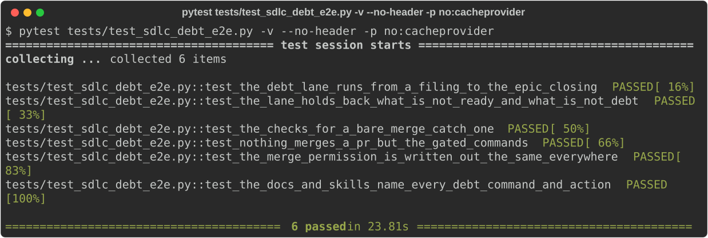
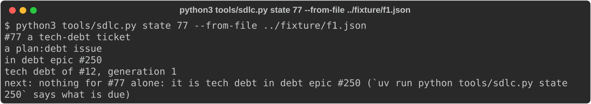 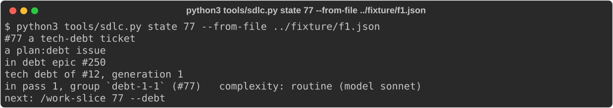
 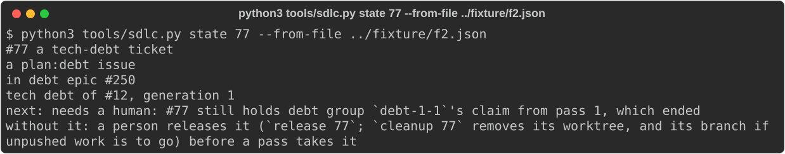
 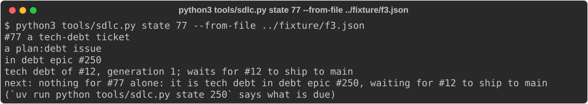 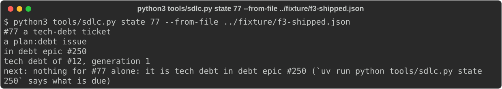
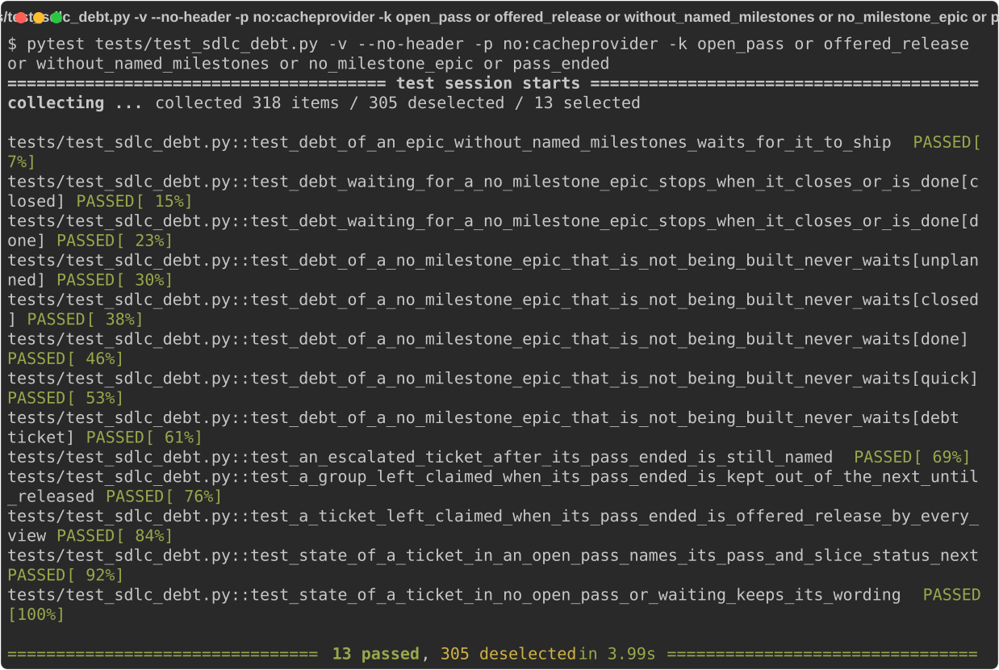
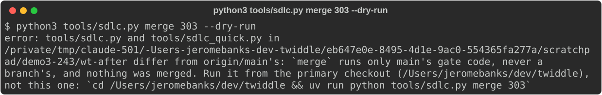
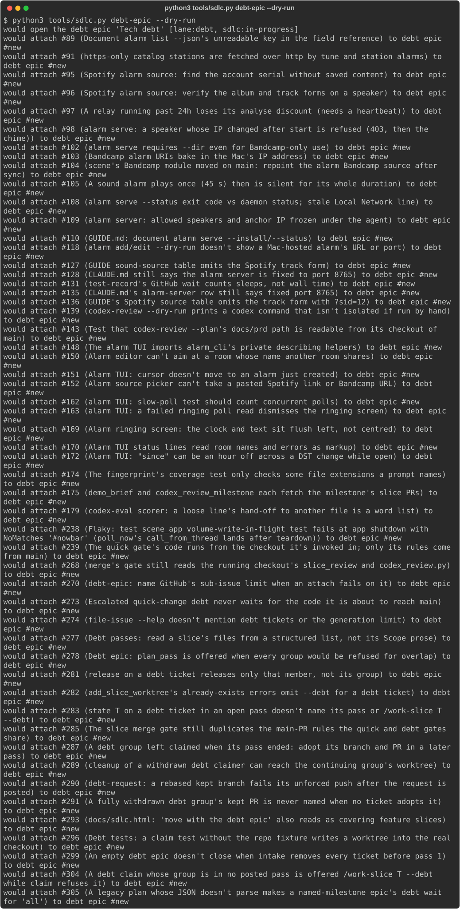 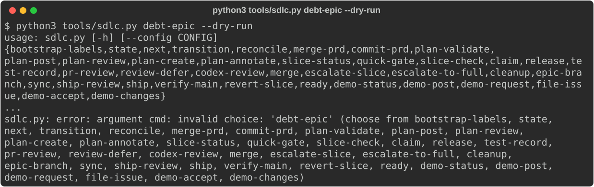
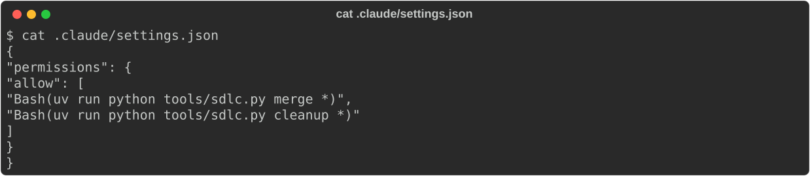 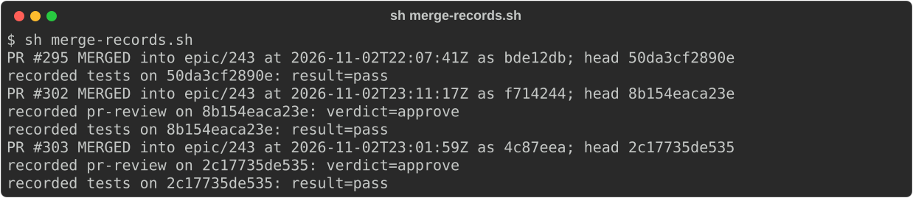
