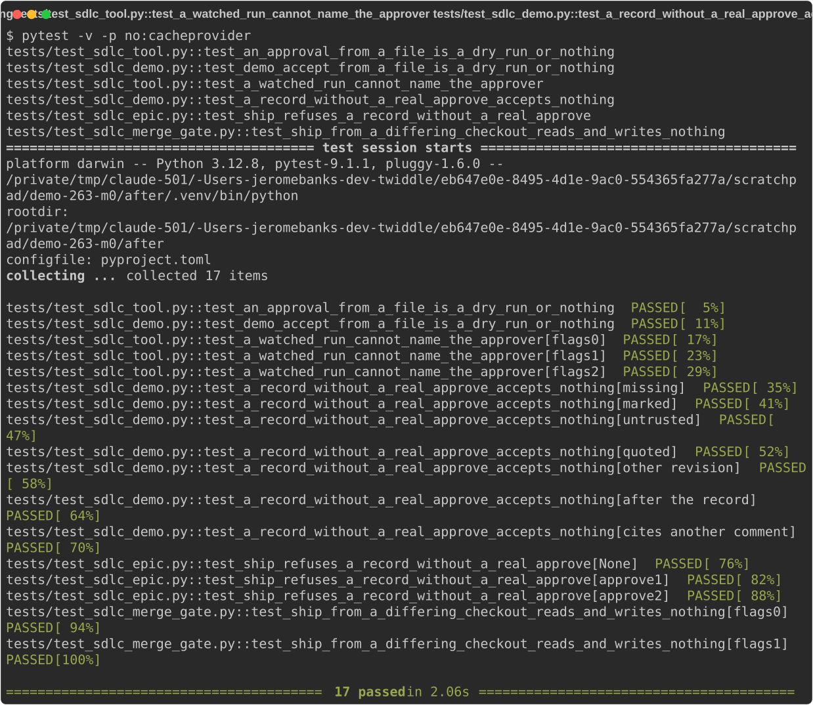
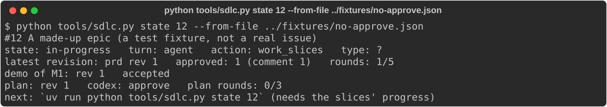
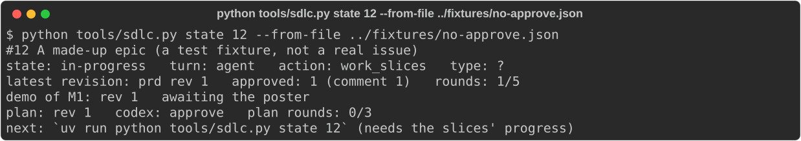
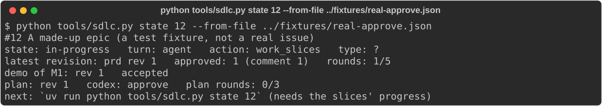
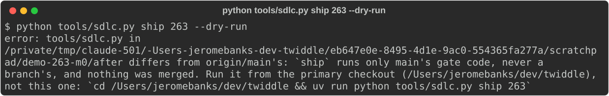
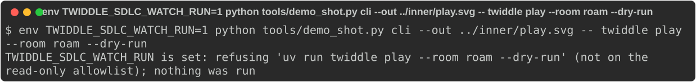
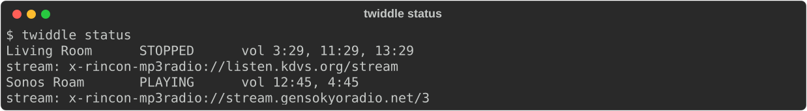

# #263 M0: Safe groundwork on main: approvals checked, demo pictures guarded

Before: `origin/main` (9933645). After: `origin/epic/263` (66b885f), which already contains `main` (no sync needed).

## What was built

- **#324 `T0.1`** (PR #333): a person's decision counts only as read from GitHub.
  - A `demo-approval` record accepts its milestone only when a real, unmarked `/approve` of that demo revision is among the issue's comments, written before the record, by a collaborator or the issue's author.
  - `demo-accept` cites the `/approve` it records (`reply=<comment id>`). A record from before `reply` still counts when a real `/approve` is there.
  - `demo-accept` and `transition --kind approval` refuse `--from-file` unless `--dry-run`.
  - Under `TWIDDLE_SDLC_WATCH_RUN`, `reconcile` refuses `--by`/`--from-file` unless `--dry-run`, and reads who added the label from the issue's events.
  - `ship` refuses unless its own `tools/sdlc.py`/`tools/sdlc_quick.py` match `origin/main`'s, as `merge` does.
- **#325 `T0.2`** (PR #329): with `TWIDDLE_SDLC_WATCH_RUN` set, `tools/demo_shot.py cli` runs only a closed, argv-matched allowlist of read-only commands, and `tui` is refused outright. With the variable unset, nothing changes.

## The steps as run

All read-only. No speaker was written to, and nothing was posted except this demo.

1. **The refusal tests** (in the `after` worktree):
   `uv run pytest -v -p no:cacheprovider` on `test_an_approval_from_a_file_is_a_dry_run_or_nothing`, `test_demo_accept_from_a_file_is_a_dry_run_or_nothing`, `test_a_watched_run_cannot_name_the_approver`, `test_a_record_without_a_real_approve_accepts_nothing`, `test_ship_refuses_a_record_without_a_real_approve` and `test_ship_from_a_differing_checkout_reads_and_writes_nothing`: 17 passed.

   

2. **`state` on two offline fixtures** (`state 12 --from-file`). They are built from `tests/test_sdlc_demo.py`'s helpers: a demo rev 1 of M1, then a `demo-approval` record.
   - `no-approve`: the record cites comment `999999`, which doesn't exist, and nobody wrote `/approve`.
   - `real-approve`: the poster's `/approve`, then a record citing it (what `demo-accept` now writes).

   | | `no-approve` | `real-approve` |
   |---|---|---|
   | `main` | accepted | accepted |
   | `epic/263` | awaiting the poster | accepted |

   
   
   

3. **`ship 263 --dry-run` from the `after` worktree**: its `tools/sdlc.py` differs from `origin/main`'s, so it refuses before any read or write (exit 1).

   

4. **Watcher-run pictures**:
   - `demo_shot.py cli` with `TWIDDLE_SDLC_WATCH_RUN=1`, asked for `uv run twiddle play --room roam --dry-run`, refused (exit 2). It ran nothing and made no output directory. To draw the refusal, an outer `demo_shot.py cli` (variable unset) ran that inner command.
   - The same inner tool, asked for `uv run twiddle status`, ran it and drew it.

   
   

## What changed from the plan

- The plan's demo refuses `twiddle play --room roam`. The picture adds `--dry-run`, so a broken guard still couldn't start the Roam. `play` isn't on the allowlist at all, so it is refused with or without the flag. `test_watch_run_refuses_everything_else` covers the plain argv.
- The plan's "approval cites no real `/approve`" fixture cites a comment ID that doesn't exist. The test covers the other cases: a missing, marked, untrusted, quoted, other-revision, or later `/approve`.

## Known gaps

- The watcher (M1) and its TUI bracket (M2) aren't built yet. This milestone is only their safety groundwork.
- The milestone's Codex review runs at ship time, after `/approve`. Both slices are judgment slices, and each had its own approved PR review.
