# #379 M1: Park an issue until another epic ships, and see it come back

Before: `main` at 7e312fe. After: `epic/379` at 59f96d0 (main already merged in; the full suite passed there, 6382 tests).
Codex reviewed the milestone twice: round 1 asked for one change (below, F1); round 2 approved 59f96d0 with no findings.

## What was built

| Slice | What | PR |
|---|---|---|
| T1.0 (#387) | The `sdlc:waiting` label in `.sdlc/config.json`, described in `docs/sdlc.html` | #396 |
| T1.1 (#388) | Reading a wait: the `waiting` state, and what `state` says about it (`turn: none`, `lift_wait`, `wait_broken`) | #394 |
| T1.2 (#389) | `wait N --on E[:Mk] --reason`: park an issue, with every refusal the PRD lists | #398 |
| T1.3 (#391) | `wait N --lift`: end a wait and put the issue back where it was | #402 |
| T1.4 (#390) | Nothing builds a waiting issue: `claim` refuses its slices, `next` lists it on one `waiting:` line | #397 |
| T1.5 (#392) | `ship E` lifts the waits on the milestone it released | #405 |
| T1.6 (#393) | Docs: `sdlc:waiting`, `wait`, `wait --lift` (SDLC.md, CLAUDE.md, the triage skill) | #407 |
| F1 (#408) | Fix from the milestone review: a preview run of triage holds `wait` and `wait --lift` for an OK too | #409 |

## The steps, as run

Everything is read-only or `--dry-run`. Nothing was posted and no label moved. The `sdlc:waiting` label doesn't exist on GitHub yet: until M1 ships, `main`'s config doesn't know it, so a real wait placed now would read as untriaged on `main`.

Where each picture's data comes from:

- **Live:** the command ran against GitHub as it is today: `bootstrap-labels --dry-run`, the refusals, the live `wait 308 --dry-run`, and the "before" picture on `main`.
- **Real snapshot:** `bundles/308-real-snapshot.json` is #308 and #263 exactly as fetched today, with nothing added.
- **Made up:** `bundles/308-made-up-*.json` is that snapshot plus one invented record each. `waiting` adds a wait comment on #308 that was never posted. `shipped` also adds a "#263's M2 shipped" record that doesn't exist. `broken` also pretends #263 was closed. Nothing here happened on GitHub.
- **Offline test worlds:** `next`, `claim` and `ship` are the slices' own offline tests (faked GitHub), printed. Their issue numbers (`#300`, `#400`, `#12` and so on) are invented and are not the real issues with those numbers.

1. **Before (main):** `sdlc.py wait ...` is `invalid choice: 'wait'`. 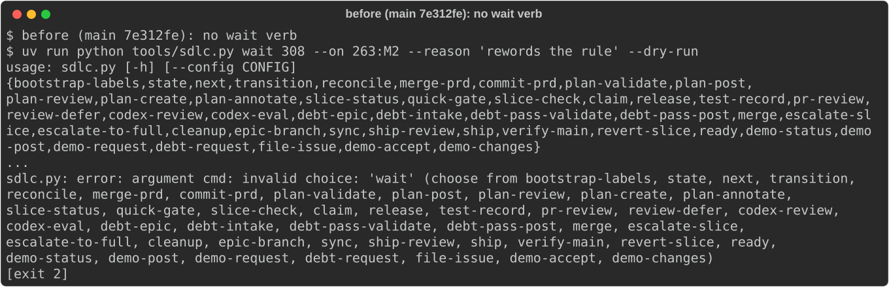
2. **The label:** `bootstrap-labels --dry-run` would create `sdlc:waiting`. 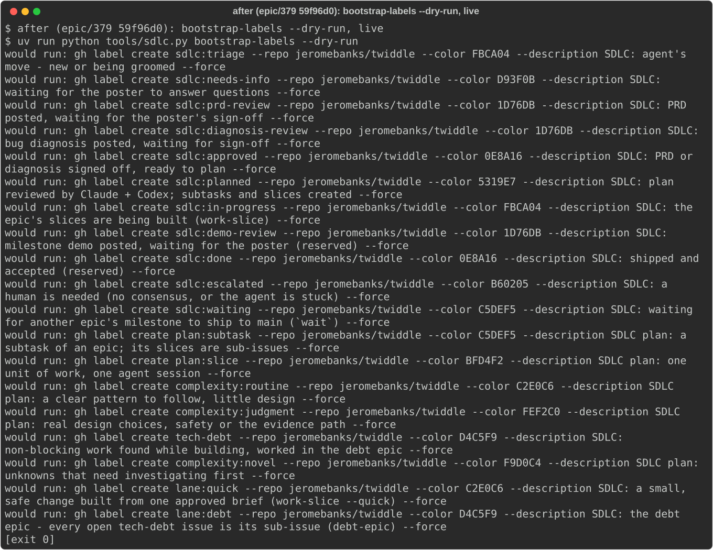
3. **Parking #308, live:** `wait 308 --on 263:M2 --dry-run` refuses because the label isn't on GitHub yet, and says to run `bootstrap-labels` (T1.2 asks for this refusal). 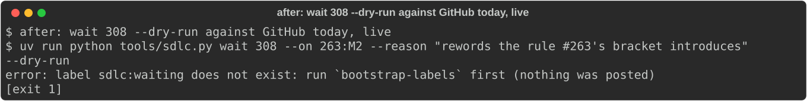
4. **Parking #308, from the real snapshot:** the same dry run prints the comment it would post and the label move `triage -> waiting`. 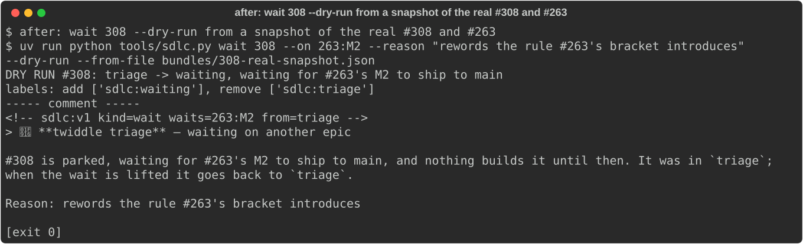
5. **What `wait` refuses (live):** a slice (#387), an epic already in progress (#379), and `--then close`, which names #378. 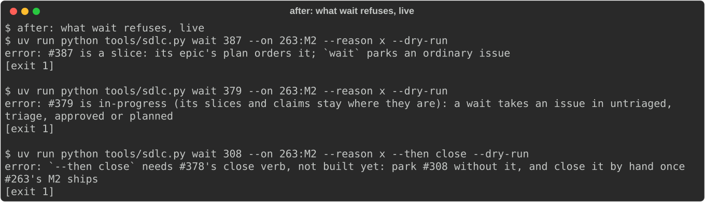
6. **What `state` says (made-up bundles):**
   - waiting: `turn: none`, nothing to do. 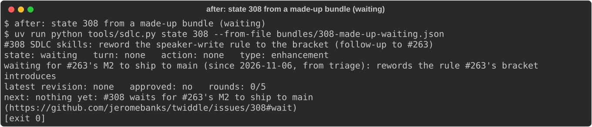
   - #263's M2 shipped: `lift_wait`, and `next` names `wait 308 --lift`. 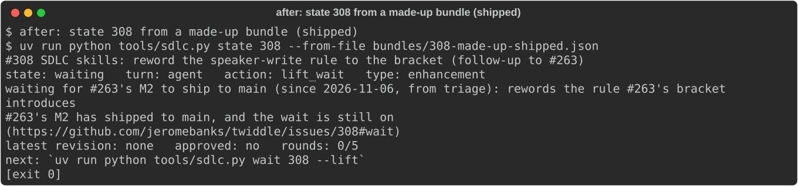
   - #263 closed without M2 shipping: `wait_broken`, a person's turn. 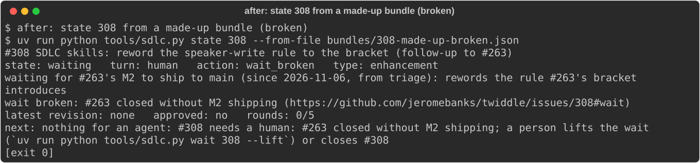
7. **Ending the wait (made-up bundle):** `wait 308 --lift --dry-run` puts #308 back in `triage`, where it was. 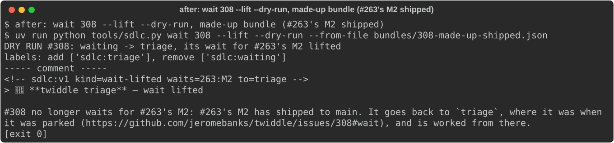
8. **`next` (offline world):** the unshipped waits sit on one `waiting:` line. `#400`, whose target shipped, is listed with `wait 400 --lift`. `#410`, whose wait is broken, isn't listed, because `next` lists agent work and that one is a person's. 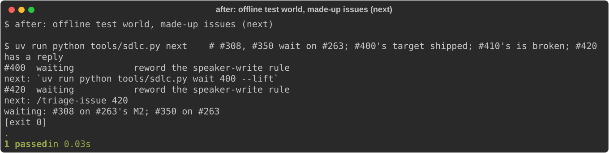
9. **`claim` (offline world):** a slice of a waiting epic is refused, and the refusal names `wait --lift`. 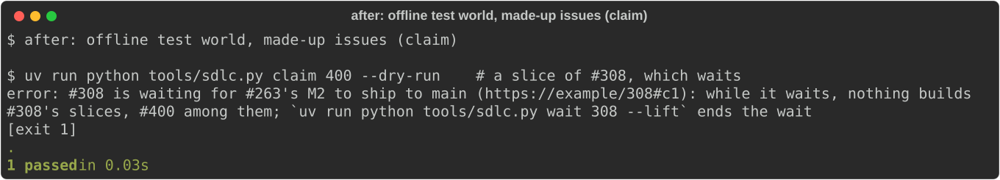
10. **`ship` (offline world):** `ship 12 --dry-run` would lift only `#300`, which waits on M1. `#301` waits on M2, and `#302` on the epic as a whole, which isn't done. 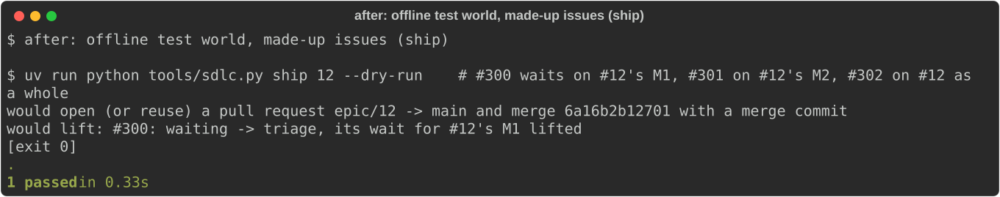

No step writes to a speaker, so nobody was asked to run anything.

## What changed from the plan

- **The live dry run of parking #308 refuses for now.** The plan's demo step said `wait 308 --on 263:M2 --dry-run` prints the comment and the label move. Against GitHub today it refuses, because the `sdlc:waiting` label doesn't exist yet. That refusal is one T1.2 was asked to make. From a snapshot of the real issues, the same dry run prints the comment and the label move (step 4).
- **F1 was added** after Codex's round-1 review of the milestone. The triage skill's preview rule (`--preview`, or `"confirm_before_posting": true`) covered `transition` only, so the new `wait` and `wait --lift` instructions could have posted without an OK. The rule now reads: "Run each of these with `--dry-run` first, show the output, and run it for real only after an OK: `transition`, `wait` (parking an issue), `wait --lift` (ending a wait), ...". An offline test holds it.

## Known gaps

- Tech debt found while building, not blocking: #399, #400, #401, #403, #404.
- #406 (the docs don't say that `ship` lifts waits) is covered by T1.6's docs. It will be closed as fixed once M1 ships.
- After M1 ships, `bootstrap-labels` must run for real before any real wait. Then #308 gets parked on #263's M2.
- `--then close` waits for #378's close verb.
